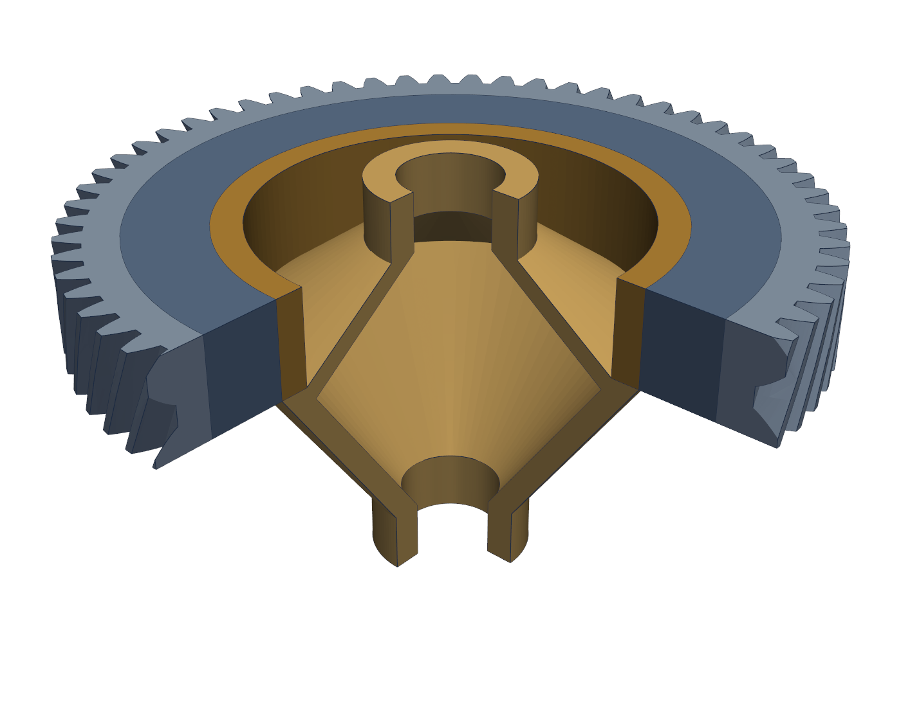
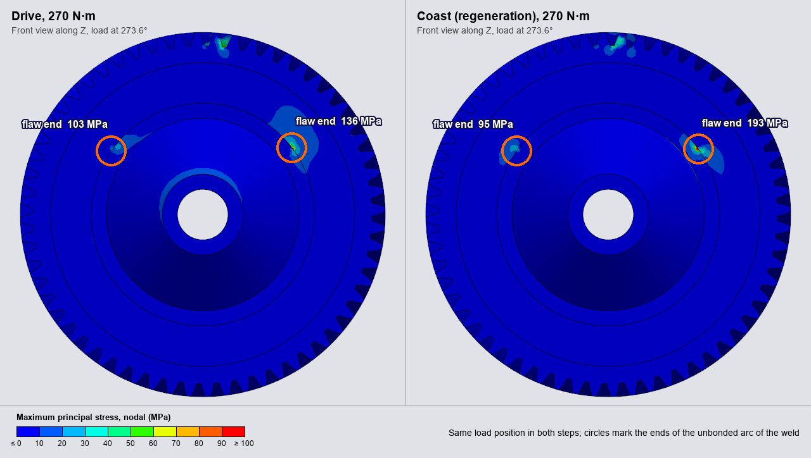
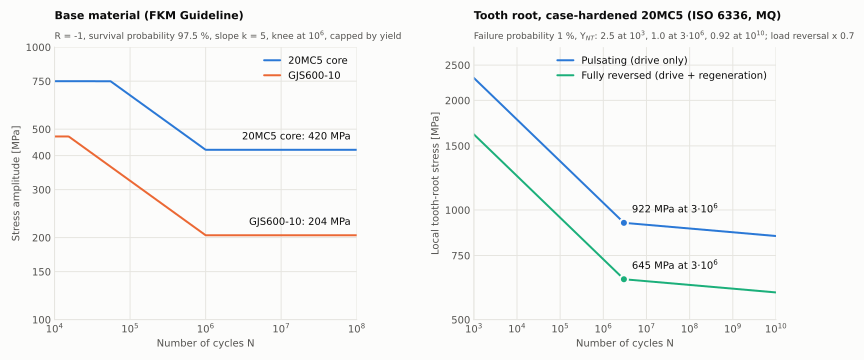

# Rolling Contact Load & Fatigue Framework for a Welded Helical Crown Gear and Differential Carrier (Abaqus DLOAD)

[](#)
[](https://www.3ds.com/)
[](#)
[](https://fortran-lang.org/)
[](../LICENSE)


---

## 1. Executive Summary

<div align="justify">
This project applies the tooth contact load of a helical gear pair <b>analytically</b>, through an Abaqus/Standard user subroutine <code>DLOAD</code>, onto the flanks of an automotive crown gear (<i>z</i> = 60, <i>m</i><sub>t</sub> = 2.903 mm, <i>β</i> = 25°) laser-welded to its differential carrier. The pinion is not meshed: the subroutine reproduces its line of action, contact ratio and rolling kinematics, so a full 360° revolution runs as a quasi-static analysis without gear-to-gear contact pairs and their convergence cost. The carrier, the weld, an incomplete-penetration weld flaw and the bearing supports are modelled explicitly.
</div>

### Key Features
- **Drive and coast (regeneration) load cases:** the active flank and the torque are selected per analysis step, so one model covers manual drivelines (drive only) and hybrid / electric drivelines with torque reversal.
- **Rolling across the full revolution (360° / 60 teeth):** every tooth root, the weld and the flaw see the complete load cycle, which is required because the flaw breaks cyclic symmetry.
- **Constant transmitted torque:** the contact line length is normalised at every mesh phase, including the truncation of the pressure band at tip and root.
- **Verified load path:** the pressure field integrates to the target torque on both flanks, and the finite element reactions at the bearing reference node match the gear force theory (Section 5).

---

## 2. Gear & Meshing Parameters

The gear data are the design parameters of the CAD model and are the inputs at the top of `dload_crown_helical.f`. As a check, an involute helicoid was fitted to the nodes of the loaded flank of the mesh: it returns the design base radius and helix (fitted $r_b = 81.85$ mm against $81.844$ mm) with a maximum residual of 0.005 mm.

| Parameter | Symbol | Value | Unit | Description |
| :--- | :---: | :---: | :---: | :--- |
| Number of teeth (wheel) | $z_2$ | $60$ | $-$ | Crown gear |
| Number of teeth (pinion) | $z_1$ | $17$ | $-$ | Mating pinion (analytical only) |
| Transverse module | $m_t$ | $2.9032$ | $\text{mm}$ | $180 / 62$ |
| Normal module | $m_n$ | $2.6312$ | $\text{mm}$ | $m_t \cos\beta$ |
| Transverse pressure angle | $\alpha_t$ | $20.0^\circ$ | $\text{deg}$ | |
| Normal pressure angle | $\alpha_n$ | $18.26^\circ$ | $\text{deg}$ | $\arctan(\tan\alpha_t \cos\beta)$ |
| Helix angle | $\beta$ | $25.0^\circ$ | $\text{deg}$ | Right-hand |
| Face width | $b$ | $25.0$ | $\text{mm}$ | $Z \in [0, 25]$ |
| Reference diameter | $d$ | $174.19$ | $\text{mm}$ | |
| Base radius | $r_b$ | $81.844$ | $\text{mm}$ | |
| Tip diameter | $d_a$ | $180.0$ | $\text{mm}$ | |
| Centre distance | $a$ | $111.77$ | $\text{mm}$ | $(d_1 + d_2)/2$ |
| Transverse / overlap contact ratio | $\varepsilon_\alpha$ / $\varepsilon_\beta$ | $1.59$ / $1.28$ | $-$ | |
| Wheel torque | $T$ | $270.0$ | $\text{N}\cdot\text{m}$ | Per load case (drive and coast) |

Conventions: wheel axis on global $Z$, angle $\theta$ by the right-hand rule about $+Z$ from $+X$ towards $+Y$. Units: mm, N, MPa, s.

---

## 3. Mathematical Formulation of Subroutine `DLOAD`

### 3.1 Transverse Kinematics & Line of Action

$$m_t = \frac{m_n}{\cos\beta}, \quad \alpha_t = \arctan\left(\frac{\tan\alpha_n}{\cos\beta}\right), \quad \tan\beta_b = \tan\beta \cos\alpha_t$$

For a surface integration point at $(x, y, z)$, the radius, involute roll distance and local pressure angle are:

$$r = \sqrt{x^2 + y^2}, \quad u_p = \sqrt{r^2 - r_{b}^2}, \quad \alpha_p = \arctan\left(\frac{u_p}{r_b}\right)$$

### 3.2 Flank Selection and Rolling Kinematics

The flank is identified from the surface name and loaded only in the step whose drive mode matches it ($m = +1$ drive on `SURF_TOOTH`, $m = -1$ coast on `SURF_TOOTH_COAST`). The load is held stationary during a smooth ramp $t_{\text{ramp}}$ and then rolls $n$ pitches in $t_{\text{roll}}$:

$$\phi_{\text{rot}}(t) = \omega \cdot \min\left(\max(0, t - t_{\text{ramp}}), t_{\text{roll}}\right), \quad \theta = \text{atan2}(y, x) + \text{dir} \cdot \phi_{\text{rot}}(t)$$

$$\delta\theta = \text{dir} \cdot m \cdot (\theta_p - \theta) + \alpha_{wt} - \alpha_p \quad \text{(wrapped to } [-\pi, \pi])$$

The contact position on the line of action is $u_c = u_p + r_b\,\delta\theta$, active for $u_A \le u_c \le u_E$ (start and end of the path of contact). Reversing $m$ mirrors the line of action onto the opposite flank at the same rotation direction, which is the kinematics of regeneration.

### 3.3 Pressure Band, Flank Relief and Torque Normalisation

Across the contact half-width $h_b$ the pressure is parabolic, weighted by an entry/exit relief $W_{\text{flank}}$ and by the inverse of the instantaneous contact line length $W_{\text{tab}}$, tabulated over one base pitch for each flank:

$$q = \frac{\delta\theta\,\left(u_p + \tfrac{1}{2} r_b\,\delta\theta\right)}{h_b}, \quad p = \frac{T}{\tfrac{4}{3}\,r_b\,h_b} \cdot S(t) \cdot \left(1 - q^2\right) \cdot W_{\text{flank}}(u_c) \cdot W_{\text{tab}}(\varphi)$$

with $\varphi = \left(u_c - u_A \pm (z - z_{\text{mid}})\tan\beta_b\right) \bmod p_{bt}$ and $S(t)$ the smoothstep load ramp.

---

## 4. Finite Element Model



*Section view of the CAD geometry: toothed rim and crown ring (blue-grey), carrier body and carrier ring (ochre). The weld interface is the cylinder at R = 55 mm between the two rings.*

| Item | Description |
| :--- | :--- |
| Master decks | `Gear_Shaft_assembly_simulation.inp` (drive) and `Gear_Shaft_assembly_drive_coast.inp` (drive + coast) |
| Mesh | 508,500 nodes, 251,210 quadratic elements, 1,488,072 equations (not stored in the repository, see Section 4.1) |
| Crown gear | Toothed rim in `C3D10` (111,490 elements) tied to a structured `C3D20` ring (24,000 elements) |
| Differential carrier | Body in `C3D10` (106,120 elements) tied to a structured `C3D20` ring (9,600 elements) |
| Weld interface | Cylindrical interface at $R = 55$ mm. Weld seam ($Z \in [20.8, 25]$ mm) bonded over a 260° arc (`NO SEPARATION`, `ROUGH`) |
| Weld flaw | Remaining 100° arc left unbonded; the full interface carries frictional contact ($\mu = 0.20$, penalty) |
| Bearing supports | Kinematic couplings from the bearing seats to reference node `RP_BEARING` on the axis, fully fixed |
| Materials | `Materials_Assembly.inp`: 20MC5 (crown), GJS600-10 (carrier), elastic-plastic |

The reaction force and moment at `RP_BEARING` are written every increment (`RM3` is the reaction torque), which gives a direct check of the transmitted load.

### 4.1 Meshing Strategy

The repository stores the CAD geometry (`Gear_Shaft_geometry.step`) instead of the 76 MB mesh. The STEP file was built with the OpenCASCADE kernel from the gear data of the subroutine and the $(r, z)$ section of the carrier, and holds the four meshing regions below as separate solids named after their element sets. Checked against the reference mesh: its surface nodes lie within 0.003 mm of the CAD surfaces and the volumes of the four regions agree within 0.1 %. The tooth root is a sharp corner between the involute flank and the root circle, as in the reference mesh; a root fillet has to be added before a tooth-root fatigue assessment. The reference mesh, which the results in Section 5 were obtained with, is built as follows and must be exported as `Gear_Shaft_geometry.inp`:

| Region | Element set | Element | Technique | Size |
| :--- | :--- | :---: | :--- | :--- |
| Crown ring at the weld | `DIAMETER_CROWN` | `C3D20` | Structured: 200 circumferential x 12 axial x 10 radial ($R$ = 55 to 75 mm) | 2.0 mm |
| Carrier ring at the weld | `DIAMETER_DIFF` | `C3D20` | Structured: 200 circumferential x 12 axial x 4 radial ($R$ = 47.5 to 55 mm) | 1.9 mm |
| Toothed rim | `TOOTH_CROWN` | `C3D10` | Free tetrahedra, refined towards the flanks | 2.3 mm mean, 2.1 mm at the flanks |
| Carrier body | `VOLUME_DIFF` | `C3D10` | Free tetrahedra | 2.3 mm mean |

- **Workflow:** a 2D surface mesh is generated first (mapped quadrilaterals on the structured rings, mapped triangles on the regular faces of the tetrahedral volumes) and the volumes are then filled with tetrahedra under element quality control. In the reference mesh the edge-length ratio of the tetrahedra has a median of 1.4 to 1.5 and a maximum of 2.5.
- **Structured hexahedra at the weld:** both sides of the interface share the same 200 x 12 face pattern, so the contact pressure and shear at the weld seam and across the flaw are resolved on regular, matching faces, and the ends of the welded arc fall on element boundaries.
- **Quadratic tetrahedra elsewhere:** the involute helical flanks and the root fillets cannot be mapped; second-order elements keep the bending stress at the tooth root accurate at this element size.
- **Transition:** tetrahedral and hexahedral regions are joined by surface-to-surface `*TIE` constraints (`TIE_CROWN`, `TIE_DIFF`).

Names the decks and the subroutine rely on: element sets as above; surfaces `SURF_TOOTH` (drive flanks), `TIE_CROWN_TOOTH`, `TIE_CROWN_DIAMETER`, `TIE_DIFF_VOLUME`, `TIE_DIFF_DIAMETER`, `CONTACT_CROWN_WELD`, `CONTACT_DIFF_WELD`, `CONTACT_CROWN_PENALTY`, `CONTACT_DIFF_PENALTY`; node sets `COUPLING_NODES_FIX_XY` and `COUPLING_NODES_FIX_Z` on the bearing seats.

The two remaining include files depend on the node and element labels of the mesh, so they are not stored either and must be written for the mesh in use:

- **`Gear_Shaft_coast_flank_surface.inp`:** the element surface `SURF_TOOTH_COAST` with the coast flanks, i.e. the free faces of `TOOTH_CROWN` lying on the mirrored involute helicoid. The same geometric criterion applied to the drive side must reproduce `SURF_TOOTH` face by face.
- **`Gear_Shaft_bearing_sets.inp`:** disjoint node sets on the bearing seats for the kinematic couplings (`COUPLING_NODES_FIX_XY`, `COUPLING_NODES_FIX_Z`).

### 4.2 Load Steps

```abaqus
*STEP, NAME=GEAR_TORQUE_DRIVE, NLGEOM=NO, INC=1000
*STATIC
0.004, 1.20, 1.0E-05, 0.004
*DSLOAD
SURF_TOOTH, PNU
SURF_TOOTH_COAST, PNU
...
*END STEP
*STEP, NAME=GEAR_TORQUE_COAST, NLGEOM=NO, INC=1000
*STATIC
0.004, 1.20, 1.0E-05, 0.004
...
*END STEP
```

Both surfaces carry the user-defined load in both steps; the subroutine returns zero on the flank that is inactive in the current step. The load case table is at the top of the subroutine:

```fortran
integer(int32), parameter :: drive_mode_step(n_cycle) = [1, -1]                        ! +1 drive, -1 coast
real(real64), parameter :: torque_step_nm(n_cycle)    = [270.0_real64, 270.0_real64]   ! Wheel torque [N.m]
```

The default coast torque equals the drive torque (fully reversed loading). It is a conservative placeholder and should be set from the regeneration torque of the target driveline.

---

## 5. Verification

### 5.1 Pressure Field Integrated Over the Flank Surfaces

The subroutine was replicated in Python and its pressure integrated over the mesh faces of each flank surface through the full revolution (121 positions):

| Load case | Surface | Torque about $Z$ | Ripple | Tangential force | Axial force |
| :--- | :--- | :---: | :---: | :---: | :---: |
| Step 1 – drive | `SURF_TOOTH` (6,823 faces) | $+270.03\text{ N}\cdot\text{m}$ | $\pm 0.06\%$ | $3297.7\text{ N}$ | $-1445.8\text{ N}$ |
| Step 2 – coast | `SURF_TOOTH_COAST` (6,837 faces) | $-270.11\text{ N}\cdot\text{m}$ | $\pm 0.13\%$ | $3298.5\text{ N}$ | $+1446.2\text{ N}$ |

The inactive flank integrates to zero in each step. Theory: $F_t = T / r_b = 3299.0\text{ N}$ and $F_a = F_t \tan\beta_b = 1445.6\text{ N}$.

### 5.2 Finite Element Reactions at the Bearing Reference Node

Drive load case on the full assembly (1.49 million equations), reaction at `RP_BEARING`:

| Quantity | Theory | Abaqus | Deviation |
| :--- | :---: | :---: | :---: |
| Reaction torque $RM_3$ | $-270.0\text{ N}\cdot\text{m}$ | $-270.13\text{ N}\cdot\text{m}$ | $0.05\%$ |
| Transverse force $\sqrt{RF_1^2 + RF_2^2}$ | $3299.0\text{ N}$ | $3298.8\text{ N}$ | $0.01\%$ |
| Axial force $RF_3$ | $1445.6\text{ N}$ | $1446.3\text{ N}$ | $0.05\%$ |

Mean values over the complete rolling phase ($t = 0.200$ to $1.200$ s, 251 increments, analysis completed in 300 increments of 0.004 s). The three reactions oscillate by $\pm 0.9\%$ about their mean through the revolution. The direction of the transverse force rotates by 1.44° per increment, i.e. 360.0° in the 1.00 s rolling phase. The coast step has been verified by integration (Section 5.1) and not yet by a finite element run.

### 5.3 Stress Results of the Drive Revolution

Nodal maximum principal stress over the drive revolution at 270 N·m, from the 31 field output frames (one every 10 increments, i.e. every 14.4° of load travel). The peak is the highest value of the cycle and the range is the principal stress range defined in Section 6:

| Zone | Peak | Range | Location |
| :--- | :---: | :---: | :--- |
| Toothed rim | $95.5\text{ MPa}$ | $115.9\text{ MPa}$ | Tooth root, near the face $Z = 0$ |
| Weld interface, ends of the flaw | $136.0\text{ MPa}$ | $136.0\text{ MPa}$ | $R = 55$ mm, $Z = 20.8$ mm, $\theta = 36.9°$ ($131.7\text{ MPa}$ at the other end, $\theta = 145°$) |
| Weld interface, bonded seam away from the flaw | $59.8\text{ MPa}$ | $61.6\text{ MPa}$ | $R = 55$ mm |
| Weld interface, inside the flaw | $15.3\text{ MPa}$ | $39.0\text{ MPa}$ | $R = 55$ mm, $\theta = 50°$ to $130°$ |
| Crown ring (`DIAMETER_CROWN`) | $62.1\text{ MPa}$ | $64.8\text{ MPa}$ | First node row next to the flaw end |
| Carrier | $58.8\text{ MPa}$ | $64.3\text{ MPa}$ | First node row next to the flaw end |



*Front view along Z at t = 0.96 s (load at 273.6°), nodal maximum principal stress at 270 N·m. The two circles mark the ends of the unbonded arc of the weld interface.*

- **Elastic response:** the equivalent plastic strain is zero in every frame and the largest displacement is 0.028 mm.
- **Governing location:** the two ends of the unbonded arc, at the start of the weld seam, carry the highest stress of the assembly, above the tooth root.
- **Flaw ends are not converged values:** the bonded-to-unbonded transition is a sharp corner, so the stress there grows with mesh refinement. These values rank the location; they are not to be compared with an S-N curve until the notch is modelled with its reference radius (Section 7.4).
- **Tooth root values are sampled:** one frame every 14.4° covers 2.4 tooth pitches, so no single tooth is captured at its worst mesh position. The tooth-root peak and range are lower bounds; a field output at every increment is needed for the root assessment.

---

## 6. Post-Processing Pipeline

- **`odb_to_vtk.py`:** exports every frame of every step from the Abaqus ODB to binary VTK unstructured grids (all solid elements: `C3D10`, `C3D20` and their reduced / hybrid variants; any unsupported type is reported), with the fields needed for the fatigue evaluation:
  - *Nodal (averaged from the element-nodal stress tensor):* displacement, von Mises, maximum and minimum principal stress. These carry the surface values at the root fillet and at the weld.
  - *Element centroid:* von Mises, maximum and minimum principal stress, equivalent plastic strain.
  - The signed principal stresses separate the tensile from the compressive half of the cycle when the torque reverses, which von Mises alone cannot do.
  - *Whole load cycle (`gear_helical_fatigue_cycle.vtk`, nodal):* peak maximum principal stress, lowest minimum principal stress and principal stress range. The range is the largest principal stress of the difference between the stress tensor at the peak and the tensor of any other frame, so it stays valid when the principal directions rotate as the load travels.
- **`compile_vtk_to_gif.py`:** renders the animation at the top of this page from the VTK frames. It plots the nodal maximum principal stress on a fixed 0 to 100 MPa scale (compression is not coloured) in three synchronised views:
  - *Pinion view:* the camera sits radially outside the crown at the loaded tooth and orbits with the load, so the meshing tooth stays in the centre.
  - *Front view along $Z$:* the gear stays still and the loaded zone travels the full 360°; the two ends of the weld flaw show as fixed spots.
  - *90° section:* a quarter of the crown and of the carrier, with one cut face through the meshing tooth, following the load.
- **`run_pipeline.sh`:** headless batch wrapper for Linux / HPC; runs the exporter and packs the VTK files into `gear_helical_vtk.zip`.

```bash
python compile_vtk_to_gif.py                  # extracts gear_helical_vtk.zip to vtk_results/ on first use
python compile_vtk_to_gif.py --frames 0,8,16  # PNG previews of selected frames
```

The angular position of the load is located in every frame from the most stressed elements of the toothed rim and fitted with a constant angular speed (largest deviation 0.5°). The VTK files are not stored in the repository (about 1.1 GB per revolution).

---

## 7. Scope of Application, Baseline Materials & Fatigue Life Estimation

### 7.1 Supported Drivelines

| Driveline | Supported | Load cycle |
| :--- | :---: | :--- |
| Manual transmission, no regeneration | **Yes** | Step 1 only: unidirectional torque on the drive flank |
| Hybrid / electric with regeneration | **Yes** | Step 1 drive + step 2 coast on the opposite flank, same rotation direction |
| Bevel / hypoid ring gears | No | The formulation assumes a cylindrical involute with a planar line of action and constant base radius |

Regeneration does not reverse the rotation: the torque reverses, the load moves to the opposite flank, the tooth root goes from pulsating to reversed bending and the shear in the weld changes sign.

### 7.2 Baseline Material System

| Component | Material | Role |
| :--- | :--- | :--- |
| Crown gear | **20MC5** case-hardening steel (20MnCr5 / 1.7147) | Tooth-root bending, flank contact |
| Differential carrier | **GJS600-10** solid-solution ferritic ductile iron (EN-GJS-600-10) | Torque reaction to the bearings |
| Laser weld | **Inconel filler wire** (nickel-based) | Dissimilar steel-to-cast-iron joint |

The weld metal is not modelled as a separate material: the joint is represented by the bonded / unbonded interface between the two bodies.

### 7.3 Fatigue Life Estimation From an OEM Load Spectrum

<div align="justify">
A service life can be estimated from the simulated stress history and the manufacturer's duty cycle. The governing quantity is the <b>stress range at each critical point over the cycle</b>, not the isolated peak of each load case:
</div>

1. **Stress history per point:** extract $\sigma(t)$ over the drive and coast revolutions at the tooth-root fillet, the weld root and the flaw tips.
2. **Load spectrum:** torque levels, number of revolutions per level and number of drive-to-coast reversals, as specified by the OEM.
3. **S-N curve per zone:** the ISO 6336 tooth-root curve for the carburized 20MC5 fillet, the FKM base-material curves elsewhere, and a welded-detail class for the joint, much lower than base material (Section 7.4).
4. **Damage sum (Palmgren-Miner [11]):** $D = \sum n_i / N_i$, with life reached at $D = 1$ (welded joints are often limited to $D = 0.3 - 0.5$).

Limits of the estimate:
- **Load scaling:** stresses scale linearly with torque at the tooth root, but not at the flaw, where the contact opens and closes; run several torque levels there instead of scaling one.
- **Weld stress:** the peak stress at a notch is mesh-dependent; use a structural (hot-spot) or effective notch stress with its matching S-N curve.
- **Residual stresses:** welding and case-hardening residual stresses are not included in this model.
- **Scatter:** S-N data carry a large scatter, so the method is reliable for ranking variants (flaw size, materials) and gives an order of magnitude for absolute life until calibrated against a bench test.

### 7.4 Design S-N Curves

No fatigue test data exist for this component, so the evaluation uses design curves built from standards. The parameters are transcribed from the cited standards and must be checked against their current editions before being used for design release.



All curves follow $\sigma(N) = \sigma_D \, (N_D / N)^{1/k}$ below the knee point $N_D$.

**Base material, FKM Guideline [5]** (stress amplitude at $R = -1$, survival probability 97.5 %, smooth polished specimen):

| Quantity | 20MC5 (core) | GJS600-10 |
| :--- | :---: | :---: |
| Tensile strength $R_m$ | $1050\text{ MPa}$ | $600\text{ MPa}$ |
| Yield strength $R_{p0.2}$ (cap of the curve) | $750\text{ MPa}$ | $470\text{ MPa}$ |
| Fatigue strength factor $f_{W,\sigma}$ | $0.40$ (case-hardening steel) | $0.34$ (spheroidal graphite cast iron) |
| Fatigue limit, tension-compression $\sigma_D$ | $420\text{ MPa}$ | $204\text{ MPa}$ |
| Fatigue limit, shear $\tau_D$ | $242\text{ MPa}$ ($0.577\,\sigma_D$) | $133\text{ MPa}$ ($0.65\,\sigma_D$) |
| Knee point $N_D$ | $10^6$ | $10^6$ |
| Slope $k$ (normal / shear stress) | $5$ / $8$ | $5$ / $8$ |
| Mean stress sensitivity $M_\sigma$ | $0.27$ | $0.29$ |

On the component these values are further reduced by notch, roughness and size factors, and raised in the 20MC5 by the case-hardened layer. In the cast iron, casting defects (microshrinkage) usually govern over the matrix [10].

**Tooth root of the case-hardened gear, ISO 6336 [2, 3]** (local fillet stress, pulsating load, failure probability 1 %, material quality MQ):

| Quantity | Value |
| :--- | :--- |
| Nominal stress number $\sigma_{F\lim}$ | $461\text{ MPa}$ (quality range ML to ME: $312$ to $525\text{ MPa}$) |
| Allowable local stress $\sigma_{FE} = \sigma_{F\lim}\,Y_{ST}$ at $3 \cdot 10^6$ cycles | $922\text{ MPa}$ ($Y_{ST} = 2.0$) |
| Life factor $Y_{NT}$, static domain ($N \le 10^3$) | $2.5$ |
| Life factor $Y_{NT}$, limited life ($10^3 < N < 3 \cdot 10^6$) | log-log interpolation from $2.5$ to $1.0$, i.e. $(3 \cdot 10^6 / N)^{0.114}$, $k \approx 8.7$ |
| Life factor $Y_{NT}$, long life (up to $10^{10}$) | $0.92$ at $10^{10}$ cycles for quality MQ ($0.85$ for ML, $1.0$ for ME) |
| Full load reversal (drive + regeneration at equal torque) | stress numbers reduced by the factor $0.7$ (ISO 6336-5, idler gear case), i.e. $645\text{ MPa}$ at $3 \cdot 10^6$ cycles |

This curve is the one to compare with the maximum principal stress at the root fillet, because it already includes the case-hardened layer and the reference notch. Measured tooth root strengths of case-carburized 20MnCr5 gears are reported in [9].

**Laser weld (20MC5 to GJS600-10 with Inconel filler wire):** the base-material curves do not apply to the joint, and no S-N data or detail class for this dissimilar laser weld were found in the open literature. The adopted strategy is the **effective notch stress approach** of the IIW recommendations [7, 8] with a **conservative class**:

1. Model the weld root and the ends of the flaw with the reference radius ($r_{ref} = 1$ mm, or $0.05$ mm for thin sections) and evaluate the maximum principal stress range in the notch.
2. Use the IIW effective notch curve for steel welds as the starting point: FAT 225 for $r_{ref} = 1$ mm and plate thickness of 5 mm or more, applied to the maximum principal stress range in the notch (stress range at $2 \cdot 10^6$ cycles, slope $m = 3$, knee at $10^7$ cycles, survival probability 97.7 %).
3. Because that class is validated for steel-to-steel welds and not for a nickel-based weld metal on cast iron, reduce it to a lower class and limit the damage sum to $D \le 0.5$ until joint tests are available.
4. Evaluate the stress range over the complete drive + coast cycle, since the shear in the weld changes sign with the torque.

The weld and the flaw tips are the region where the contact opens and closes, so they are expected to govern the life of the assembly.

---

## 8. References

1. ISO 6336-1:2019, *Calculation of load capacity of spur and helical gears — Part 1: Basic principles, introduction and general influence factors*.
2. ISO 6336-3:2019, *Calculation of load capacity of spur and helical gears — Part 3: Calculation of tooth bending strength*.
3. ISO 6336-5:2016, *Calculation of load capacity of spur and helical gears — Part 5: Strength and quality of materials*.
4. ISO 21771:2007, *Gears — Cylindrical involute gears and gear pairs — Concepts and geometry*.
5. Forschungskuratorium Maschinenbau (FKM), *Analytical Strength Assessment of Components Made of Steel, Cast Iron and Aluminium Materials in Mechanical Engineering*, 7th edition, VDMA Verlag, 2020.
6. EN 10084:2008, *Case hardening steels — Technical delivery conditions*; EN 1563:2018, *Founding — Spheroidal graphite cast irons*.
7. Hobbacher, A. F., *Recommendations for Fatigue Design of Welded Joints and Components*, 2nd edition, IIW Collection, Springer, 2016.
8. Fricke, W., *IIW Recommendations for the Fatigue Assessment of Welded Structures by Notch Stress Analysis*, Woodhead Publishing, 2012.
9. Winkler, K. J., Schurer, S., Tobie, T., Stahl, K., "Investigations on the tooth root bending strength and the fatigue fracture characteristics of case-carburized and shot-peened gears of different sizes", *Proceedings of the Institution of Mechanical Engineers, Part C*, 233(21–22), 7338–7349, 2019. [doi:10.1177/0954406219841650](https://doi.org/10.1177/0954406219841650)
10. Mourujärvi, A., Vaara, J., Laine, J., Ryti, O., Jalava, K., Orkas, J., "Fatigue Properties of Heavy Section GJS-600-10 Cast Iron Castings", *International Journal of Metalcasting*, 2026. [doi:10.1007/s40962-026-01919-1](https://doi.org/10.1007/s40962-026-01919-1)
11. Palmgren, A., "Die Lebensdauer von Kugellagern", *VDI-Zeitschrift*, 68, 339–341, 1924; Miner, M. A., "Cumulative damage in fatigue", *Journal of Applied Mechanics*, 12, A159–A164, 1945.

---

## 9. Repository Structure

```text
01_dload_gear_fatigue/
├── dload_crown_helical.f                 # Fortran DLOAD subroutine: drive + coast, thread-safe
├── Gear_Shaft_assembly_simulation.inp    # Master deck: drive revolution (single step)
├── Gear_Shaft_assembly_drive_coast.inp   # Master deck: drive + coast revolutions (two steps)
├── Gear_Shaft_geometry.step              # CAD geometry: crown gear + differential carrier
├── Materials_Assembly.inp                # 20MC5 and GJS600-10 material cards
├── odb_to_vtk.py                         # Abaqus Python ODB to VTK exporter
├── compile_vtk_to_gif.py                 # Three-viewport GIF compiler (nodal maximum principal stress)
├── run_pipeline.sh                       # Headless Linux / HPC batch extraction script
└── README.md                             # Technical documentation
```

The earlier single-crown model (wheel axis on $Y$, $m_n = 3.0$ mm) and its results remain available in the repository history.

---

## 10. Author & Contact

**Victor Maia**  
- **Email:** [vhfm08@gmail.com](mailto:vhfm08@gmail.com)  
- **GitHub:** [@vhfmaia](https://github.com/vhfmaia)  
