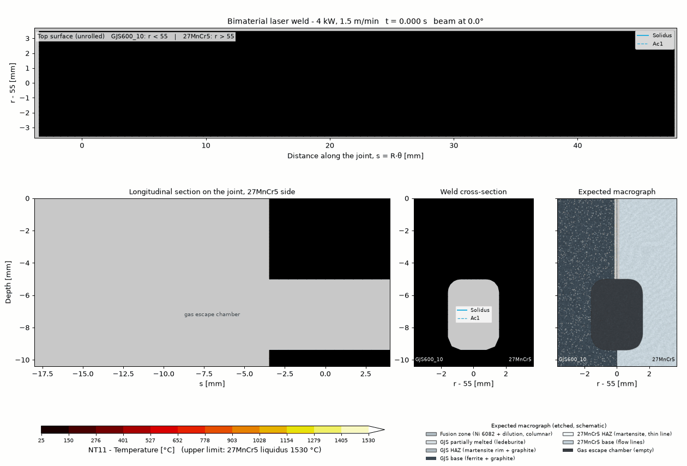
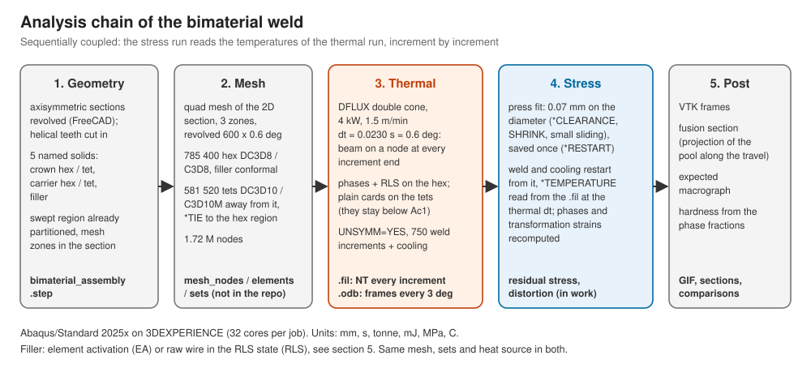
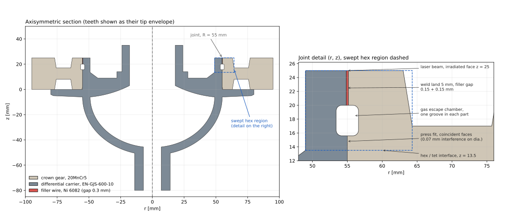
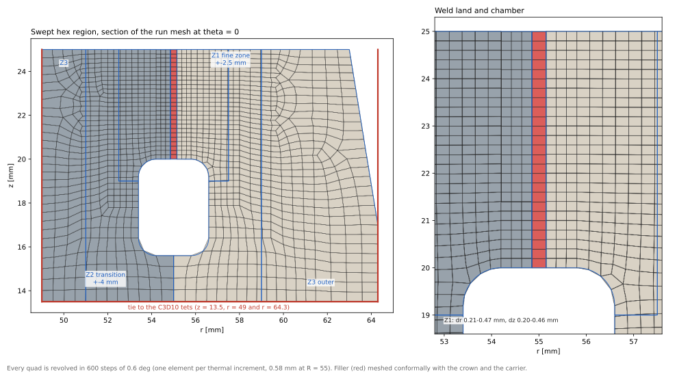
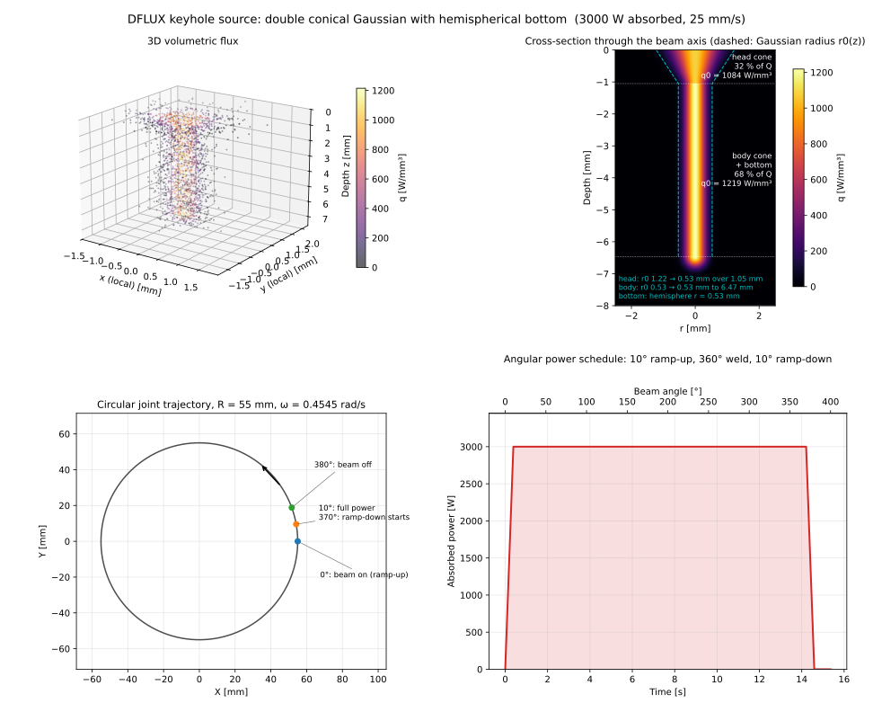
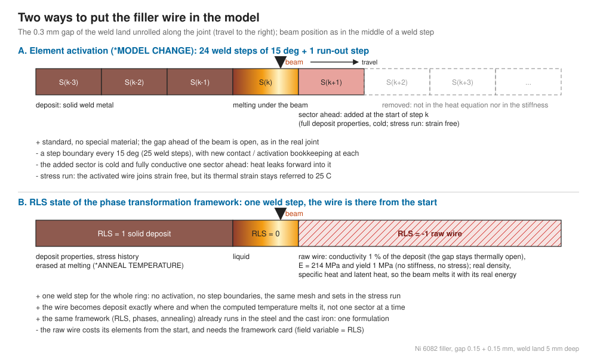
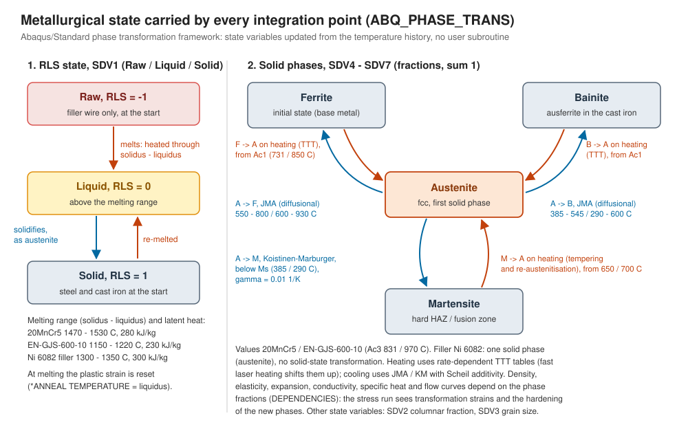
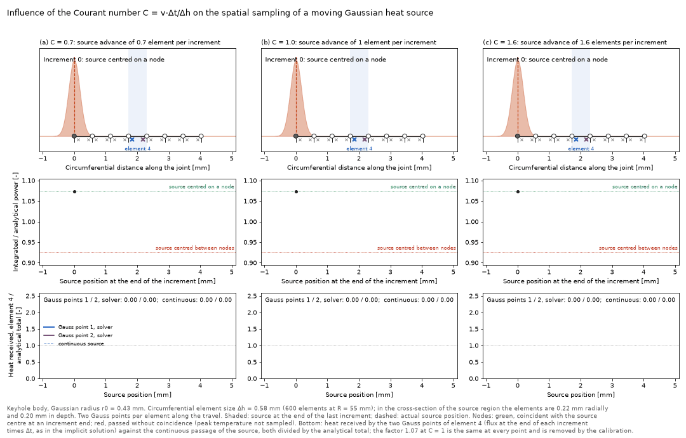
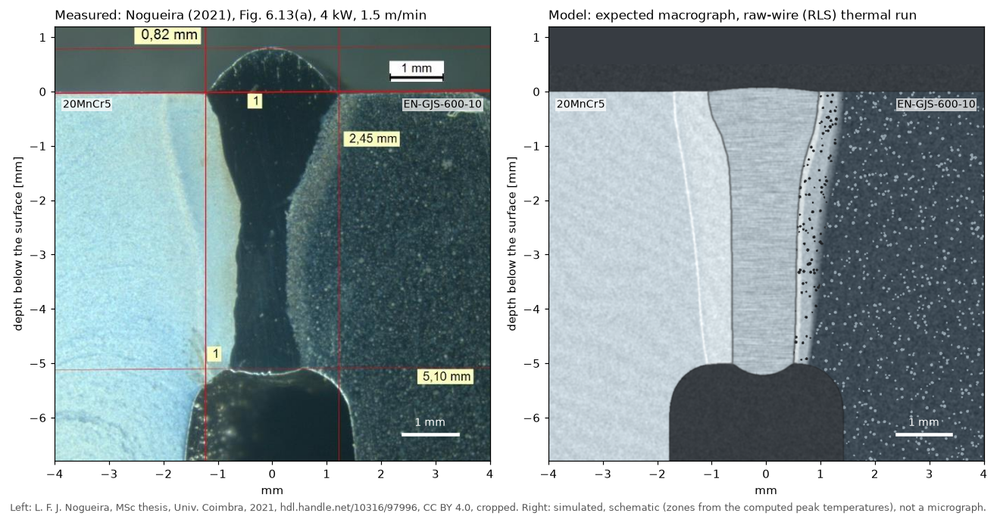
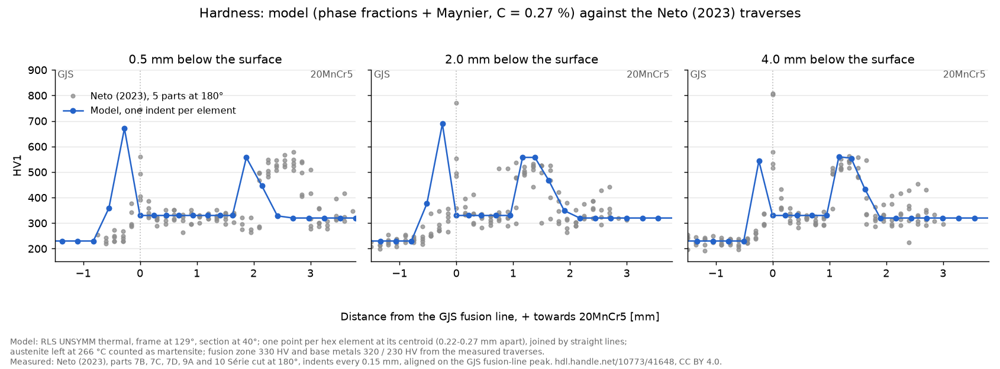

# Laser Welding of a Steel Crown Gear to a Cast-Iron Differential Carrier

### Moving keyhole heat source (DFLUX), metallurgical phase transformations and a raw-wire filler model in Abaqus/Standard

[](#9-results-thermal-run)
[](#8-stress-analysis-in-work)
[](https://www.3ds.com/)
[](#4-heat-source-double-conical-keyhole-dflux)
[](https://fortran-lang.org/)
[](../LICENSE)

A 20MnCr5 crown gear is laser welded to an EN-GJS-600-10 spheroidal graphite cast-iron differential carrier, with a nickel filler wire (Ni 6082) fed into a 0.3 mm gap. The weld runs once around the joint (R = 55 mm, 4 kW, 1.5 m/min), penetrates the whole 5 mm weld land and vents through its root into a gas escape chamber; below the weld, the crown is press fitted on the carrier. The model is a sequentially coupled thermal / stress analysis in Abaqus/Standard: a double conical keyhole heat source in a <code>DFLUX</code> subroutine, the built-in metallurgical phase transformation framework in all three materials, and the filler wire carried as a <b>raw wire</b> in the RLS state of that framework, compared with the classic <b>element activation</b>.

<p align="center">
  
</p>
<p align="center"><i>Thermal run (raw-wire filler), 0 to 57 deg: unrolled top surface, longitudinal section on the joint, weld cross-section (projection of the pool along the travel) with the solidus and Ac1 lines, and the expected macrograph. The pool is steady from about 33 deg.</i></p>

---

## Contents

1. [The joint and the analysis chain](#1-the-joint-and-the-analysis-chain)
2. [Geometry](#2-geometry)
3. [Mesh: swept hex weld region tied to tetrahedra](#3-mesh-swept-hex-weld-region-tied-to-tetrahedra)
4. [Heat source: double conical keyhole (DFLUX)](#4-heat-source-double-conical-keyhole-dflux)
5. [Filler wire: raw wire (RLS) against element activation](#5-filler-wire-raw-wire-rls-against-element-activation)
6. [Materials and phase transformations](#6-materials-and-phase-transformations)
7. [Thermal analysis](#7-thermal-analysis)
8. [Stress analysis (in work)](#8-stress-analysis-in-work)
9. [Results: thermal run](#9-results-thermal-run)
10. [Files and how to run](#10-files-and-how-to-run)
11. [References](#11-references)

---

## 1. The joint and the analysis chain

| Process | Value |
| :--- | :--- |
| Laser power, absorbed | 4 000 W nominal; 0.516 stays in the weld land (full penetration, part of the beam leaves through the root): 2 064 W |
| Travel speed | 1.5 m/min (25 mm/s), joint radius R = 55 mm, angular speed 0.4545 rad/s |
| Heat input | 160 J/mm nominal, 120 J/mm absorbed |
| Weld | 10 deg ramp-up, 360 deg at full power, 10 deg ramp-down (overlap), off at 380 deg, run-out to 450 deg, then 300 s of cooling |
| Joint | weld land 5 mm deep, filler gap 0.15 mm (crown) + 0.15 mm (carrier), gas escape chamber under it, press fit below (0.07 mm interference on the diameter) |
| Materials | crown 20MnCr5, carrier EN-GJS-600-10 (ferritic, 4.2 % Si), filler Ni 6082 (ERNiCr-3) |

<p align="center">
  
</p>

---

## 2. Geometry

<p align="center">
  
</p>

The crown gear and the carrier are axisymmetric sections revolved about the z axis, with helical teeth cut into the crown (52 teeth, normal module 3, helix 25 deg). The joint is at R = 55 mm and the irradiated face at z = 25, the frame of the <code>DFLUX</code>. From the irradiated face down: the 5 mm weld land with the 0.3 mm filler gap, the gas escape chamber (one rounded groove machined in each part, so the root of the full-penetration keyhole vents into it), the press fit with a 2 mm x 15 deg lead-in chamfer, and the crown base resting on the carrier flange.

The general arrangement (crown bore welded to a carrier seat wall, gas escape chamber, press fit under the weld) follows published joints of this type [1, 7]; <b>every dimension is the author's own</b>, chosen for this model. The geometry is built by a parametric FreeCAD script (not included) and exported as <a href="THERMAL_RLS/bimaterial_assembly.step"><code>bimaterial_assembly.step</code></a> with five named solids, already split for the mesh of section 3: <code>CROWN_HEX</code>, <code>CROWN_TET</code>, <code>CARRIER_HEX</code>, <code>CARRIER_TET</code> and <code>FILLER</code>.

| Part | Main dimensions [mm] |
| :--- | :--- |
| Crown gear | bore r = 55, tooth tips r = 89.06, face width 25 (z 0 to 25); hub r <= 63, rim r >= 77, web z 8 to 17 |
| Weld land | z 20 to 25; gap r 54.85 to 55.15 (filler solid) |
| Gas escape chamber | z 15.6 to 20.0, groove 1.6 mm deep in each part, corner radius 0.8 |
| Press fit | z 2.0 to 15.6, coincident faces at r = 55 (interference applied in the stress run) |
| Carrier | seat wall r 49 to 55, flange r <= 80 under the crown base, hollow elliptical bowl, lower and upper hubs |

---

## 3. Mesh: swept hex weld region tied to tetrahedra

<p align="center">
  
</p>

The mesh follows what the weld needs, and nothing more:

- **A swept hex region where the heat source passes** (r 49 to 64.3 mm, z 13.5 to 25, the dashed box of section 2). Its 2D section is meshed with quadrilaterals in ANSA and revolved about the axis in **600 steps of 0.6 deg**. The section is split into three zones before meshing (outlined in blue above):
  - **Z1, fine zone**, +-2.5 mm about the joint, from the irradiated face to 1 mm below the top of the chamber: elements of 0.20 to 0.47 mm, so the 1 mm wide body of the weld spans several elements;
  - **Z2, transition**, +-4 mm about the joint, down to the bottom of the region;
  - **Z3, outer**, coarsening towards the tie planes.
- **The filler solid is meshed conformally** with the crown and the carrier: the three sections are fused before meshing, so the nodes of the 0.3 mm gap (one element across, 25 along the 5 mm land) are shared node to node with both parts. No tie or contact sits inside the weld.
- **Tetrahedra everywhere else** (linear, DC3D4 / C3D4): teeth, web, rim, flange, bowl and hubs. They are joined to the hex region by surface-to-surface `*TIE` (with node adjustment) on three faces, z = 13.5, r = 49 and r = 64.3: 6 mm and more to the side of the joint, and 2.1 mm under the gas escape chamber, out of the pool and its heat-affected zone.

| Why | How |
| :--- | :--- |
| One element per increment | 0.6 deg = 0.58 mm at R = 55 (circumferential size; 0.22 mm radially and 0.20 mm in depth in the source region); the thermal increment is dt = 0.6 deg / omega = 0.023038346126 s, so the beam axis sits on a node at every increment end. The source integrated on the mesh then varies by less than its calibration factor (between two nodes it would lose 10 %, the body radius 0.43 mm being smaller than the circumferential element). All step times and time points are exact multiples of dt, written with 12 decimals, so Abaqus never inserts tiny increments to reach them. |
| Smooth fusion line | Structured hex elements aligned with the travel give the pool a smooth boundary and the same element shape at every angle. The weld is steady from about 33 deg, so every section after that is the same weld. |
| Cost | Hex where the gradients are, tets where they are not: 785 400 hex and 581 520 tets. |
| Transformations only where they happen | The tets stay below Ac1 (at most 344 C on the tie faces in the thermal run, against Ac1 = 731 / 850 C), so they carry plain temperature-dependent cards without the phase framework (section 6). This saves about a third of the run time. |

| Mesh | Thermal | Stress |
| :--- | :--- | :--- |
| Swept hex region | DC3D8: crown 426 000, carrier 344 400, filler 15 000 (1 309 quads x 600) | C3D8 |
| Tetrahedra | DC3D4: crown 266 169, carrier 315 351 | C3D4 |
| Nodes | 961 774 | same nodes |

<b>Linear tets.</b> The first runs used quadratic tets (DC3D10 / C3D10M, 1.72 million nodes). The stress run then needed more memory per MPI rank than the HPC node gives to the direct solver (35 GB against 30.6 GB on rank 0, 5.1 million equations), so the tets were changed to linear ones with the same corner nodes: 0.96 million nodes, about 2.9 million equations in the stress run. The tets carry no weld gradient (they stay below Ac1); the price is a stiffer body away from the joint and a coarser contact pressure on the tet part of the press fit.

The mesh files (<code>mesh_nodes.inp</code>, <code>mesh_elements_TH.inp</code> / <code>_ME.inp</code>, <code>mesh_sets_RLS_TH.inp</code> / <code>_ME.inp</code>, about 250 MB) are not in the repository; the decks include them by name. They are written from the ANSA export, with the element sets, the 24 filler sectors of the element activation, the hex / tet tie surfaces and the contact surfaces of the press fit.

---

## 4. Heat source: double conical keyhole (DFLUX)

<p align="center">
  
</p>

A laser keyhole weld has a "nail head" shape: a wide, shallow head at the surface over a narrow, nearly parallel body. <a href="THERMAL_RLS/dflux_bimaterial_keyhole.f"><code>dflux_bimaterial_keyhole.f</code></a> builds it from two truncated Gaussian cones of the TDC type [3, 4], each normalised over its own volume, with a hemispherical tip. At depth <i>&zeta;</i> below the surface and distance <i>r</i> from the beam axis:

$$q(r,\zeta) = q_{0,i}\,\exp\left(-\frac{3\,r^2}{r_0(\zeta)^2}\right) g(\zeta)$$

| Part | Depth | Radius r0 | Power |
| :--- | :--- | :--- | :--- |
| Head cone | 0 to d_up = 0.75 mm | r_top = 1.02 to r_mid = 0.45 mm | f_up = 42 % of Q |
| Body cone | d_up to 4.78 mm | r_mid = 0.45 to r_bottom = 0.42 mm | 58 % of Q, with the tip |
| Tip | below 4.78 mm | 0.42 mm, g = exp(-3 (zeta - 4.78)^2 / 0.42^2) | hemispherical closure, penetration 5.2 mm at 5 % of the peak |

$$q_{0,\mathrm{up}} = \frac{3 f_\mathrm{up} Q}{\pi V_\mathrm{up}}, \qquad V_\mathrm{up} = \frac{d_\mathrm{up}\left(r_\mathrm{top}^2 + r_\mathrm{top} r_\mathrm{mid} + r_\mathrm{mid}^2\right)}{3}, \qquad q_{0,\mathrm{low}} = \frac{3\,(1 - f_\mathrm{up})\,Q}{\pi\,(V_\mathrm{low} + V_\mathrm{tip})}$$

with <i>Q</i> = 2 064 W absorbed in the weld land (&eta; = 0.516 of the 4 kW), so that the source integrates to <i>Q</i> for any split. The beam moves on the circle R = 55 mm at the travel speed, with the power schedule of section 1.

<b>Calibration.</b> The source is fitted to the fusion zone of the published macrograph of this type of joint, Nogueira (2021), Fig. 6.13(a) [1]: 2.45 mm wide at the surface, a neck of 0.83 mm at 2.24 mm, full penetration of the 5 mm land.

- **First calibration** (conduction surrogate, constant properties, semi-infinite body): the source reached 7.1 mm, its power below the land lost in the gas escape chamber, with &eta; = 0.75. The Abaqus run with it reproduced the surface and the root but not the neck (1.32 mm at 2.24 mm, +59 %, section 9): the surrogate has no latent heat, no liquid conductivity and no chamber, and underestimates the body.
- **Second calibration** (the source above): the ratio of the Abaqus width to the surrogate width at each depth, taken from the first run, is kept fixed (space mapping), and the source is fitted so that ratio x surrogate matches the macrograph down to 4.2 mm. The source now ends at the measured penetration (5.2 mm), and the power that a full-penetration keyhole sends through its open root into the chamber is carried by the absorption: &eta; = 0.516 of the beam stays in the land. Predicted widths at 0.15 / 1.12 / 2.24 / 3.51 mm: 2.26 / 1.68 / 0.95 / 0.85 mm against 2.38 / 1.68 / 0.83 / 0.93 mm measured. The ratios come from the run with the first source, so the next thermal run is also the check of this calibration.

A factor of 0.963 corrects the power integrated on the actual mesh with the beam on a node (2 133 W integrated for the 2 054 W of the source inside the land).

---

## 5. Filler wire: raw wire (RLS) against element activation

<p align="center">
  
</p>

The filler wire fills a 0.3 mm gap that is open ahead of the beam and becomes weld metal behind it. The model uses the raw wire of the RLS state (B). The classic element activation (A) was run on the same mesh, sets and heat source as a comparison, and is not kept:

**A. Element activation (EA)**, comparison run only. The filler is cut into 24 sectors of 15 deg (sets `FILLER_S01` to `FILLER_S24`). All but the first two are removed at the start (`*MODEL CHANGE, REMOVE`), and each weld step adds the next sector one step ahead of the beam (`*MODEL CHANGE, ADD`; in the stress run `ADD=STRAIN FREE`). It needs no special material, but it cuts the weld into 25 steps, adds a cold, fully conductive sector one step ahead of the pool, and in the stress run the activated wire joins strain free with its thermal strain still referred to 25 C.

**B. Raw wire in the RLS state (RLS)**, the model. The phase transformation framework of Abaqus (section 6) carries, at every integration point, an **RLS** state: **R**aw = -1, **L**iquid = 0, **S**olid = 1. It is meant for powder-bed additive manufacturing, where unmelted powder (raw) melts and solidifies as dense metal. Here the raw state is the **wire**:

- the whole filler is in the model from the first increment, with `*INITIAL CONDITIONS, TYPE=SOLUTION` RLS = -1 on the set `FILLER`;
- `Material_Inconel82_RLS.inp` makes the conductivity, the elastic modulus and the yield stress depend on RLS (field variable 1). Raw wire: **1 % of the deposit conductivity**, so the gap ahead of the beam stays thermally open, as with element activation; **E = 214 MPa and yield 1 MPa**, so it carries no load and no stress in the stress run;
- density, specific heat, latent heat and expansion are those of the deposit: the beam heats and melts the wire with its real heat capacity and its real latent heat of fusion;
- when the wire melts (RLS = 0) it takes the deposit properties, and solidifies (RLS = 1) as Ni 6082 weld metal. `*ANNEAL TEMPERATURE` at the liquidus clears any plastic strain it had.

**Why only the raw wire.** Both methods were run with the same unsymmetric solver and the same tet cards, and compared node by node over the first 45 deg:

- **Same weld.** The solidus widths agree within 0.4-1.9 % (0.01-0.02 mm, a tenth of the element), the Ac1 widths within 0.2-2.4 %; the base metal above Ac1 differs by 5.9 K on average. The raw-wire pool is the slightly wider one at every depth. The only local difference sits in the filler band, 0.6 deg ahead of the beam: there the activated sector is already fully conductive while the raw wire still insulates (+318 K in EA on the steel side of the gap).
- **Same cost.** With the same tet cards both run at the same pace (5.76 min per increment) and need the same 7 iterations per increment once the pool is steady; the element activation needs 10 % more iterations while the pool forms (8.2 against 7.4).
- **What decides it is the stress run.** The activated wire joins strain free, with its thermal strain still referred to 25 C, one sector at a time, and every sector boundary is a step. The raw wire is in the model from the first increment, carries no load until it melts, and its history is erased at the liquidus: the wire becomes weld metal where and when the computed temperature melts it, in one step for the whole ring.

All three materials are then one formulation (the base metals already melt and solidify in the framework), and the thermal and stress runs share the same mesh and sets with no activation bookkeeping. The price is a raw wire present from the start and a filler card written in the framework format. The model is validated with the raw wire only.

| | Element activation (EA) | Raw wire (RLS) |
| :--- | :--- | :--- |
| Weld steps | 24 sectors + run-out (25) | 1 |
| Filler ahead of the beam | removed (no heat, no stiffness) | present, 1 % conductivity, no stiffness |
| Becomes weld metal | when its sector is added, one step ahead | when the computed temperature melts it |
| Stress run | `*MODEL CHANGE, ADD=STRAIN FREE` per sector | nothing to do: raw wire is quiet, melting erases its history |
| Material card | plain deposit card | deposit card in the framework, properties versus RLS |

---

## 6. Materials and phase transformations

<p align="center">
  
</p>

The crown, the carrier and the filler use the built-in metallurgical phase transformation framework of Abaqus/Standard (<code>ABQ_PHASE_TRANS</code>), with no user subroutine: material names starting with <code>ABQ_PHASE_TRANS_</code>, the table types of <a href="THERMAL_RLS/Material_phase_trans_table_types.inp"><code>Material_phase_trans_table_types.inp</code></a> (included once per model) and <code>*PARAMETER TABLE</code> / <code>*PROPERTY TABLE</code> data in each card. The same card is used by the thermal and the stress decks.

| State variable | Meaning |
| :--- | :--- |
| SDV1 | RLS state: raw (-1), liquid (0), solid (1) |
| SDV2 | columnar grain fraction (solidification morphology) |
| SDV3 | grain size |
| SDV4 to SDV7 | phase fractions: ferrite, austenite, bainite, martensite (sum 1) |

| | 20MnCr5 (crown) | EN-GJS-600-10 (carrier) | Ni 6082 (filler) |
| :--- | :--- | :--- | :--- |
| Melting range, latent heat | 1470 to 1530 C, 280 kJ/kg | 1150 to 1220 C, 230 kJ/kg | 1300 to 1350 C, 300 kJ/kg |
| Initial state | ferrite (base metal), RLS = 1 | ferritic matrix with graphite, RLS = 1 | raw wire, RLS = -1 |
| Heating | F, B -> A from Ac1 = 731 C (Ac3 = 831 C), M -> A from 650 C; rate-dependent TTT tables | F, B -> A from Ac1 = 850 C (Ac3 = 970 C), M -> A from 700 C | none (single phase) |
| Cooling | A -> F 550 to 800 C and A -> B 385 to 545 C (JMA); A -> M below Ms = 385 C (Koistinen-Marburger, gamma = 0.01 1/K) | A -> F 600 to 930 C, A -> B 290 to 600 C (ausferrite), A -> M below 290 C | none |
| Card | `Material_20MnCr5.inp` | `Material_GJS600_10.inp` | `Material_Inconel82_RLS.inp` |

<b>Properties depend on the phases.</b> Density, elastic constants, thermal expansion, conductivity, specific heat and the flow curves are given per phase (<code>DEPENDENCIES</code> on the phase fractions), so the thermal run sees the heat capacity of each phase and the stress run sees the transformation strains and the hardening of bainite and martensite. The specific heat carries the magnetic (Curie) peak on the ferrite only; the ferrite and austenite curves meet at Ac3, so the switch causes no jump in heat capacity.

<b>Thermal expansion is secant.</b> Abaqus integrates <code>*EXPANSION</code> as a secant coefficient from the reference temperature, so each phase carries the mean coefficient of its own strain curve: the phase strains are tied to each other by the specific volumes of ferrite, austenite and martensite, which gives transformation strains of the right sign and size (contraction on austenitisation, expansion at Ms), and the strain is frozen above the liquidus (no strain collapse in the liquid). <code>*ANNEAL TEMPERATURE</code> at the liquidus resets the plastic strain of molten metal.

<b>Tetrahedra.</b> <code>Material_20MnCr5_TET.inp</code> and <code>Material_GJS600_10_TET.inp</code> are the same materials with one phase (the as-delivered one) and temperature-dependent properties only, for the tets away from the weld, which stay below Ac1 (at most 344 C on the tie faces).

<b>Data.</b> The cards are estimated, not measured: the 20MnCr5 card is a 16MnCr5 card shifted with published composition relations (transformation kinetics after Li et al. [5], Ac1 / Ac3 / Ms from a steel producer datasheet), the cast-iron card is a first approximation from EN 1563 and the literature, and the filler card follows public data for ERNiCr-3. Each card lists its sources in its header. Not modelled: the enthalpy of the solid-state transformations, ledeburite in the partially melted cast iron, and transformation plasticity.

---

## 7. Thermal analysis

| Item | Setting |
| :--- | :--- |
| Elements | DC3D8 (hex region and filler), DC3D4 (tets) |
| Steps | RLS: `WELD` (0 to 450 deg, 750 increments) and `COOLING` (300 s); EA: `WELD_S01` to `WELD_S24` (25 increments each), `WELD_END` (150), `COOLING` |
| Increment | fixed dt = 0.023038346126 s in the weld (0.6 deg, beam on a node, section 7.1); `DELTMX` 50 K in the cooling |
| Solver | `UNSYMM=YES` (section 7.5) |
| Boundary conditions | convection 21 W/m2.K and radiation (emissivity 0.8 on the weld top, 0.6 elsewhere) on the free faces; the closed chamber is adiabatic |
| Press fit | gap conductance 10 kW/m2.K on the bore / seat and base / flange faces, falling to zero at 0.05 mm clearance |
| Output | `*NODE FILE` NT at every increment (read by the stress run); field output every 3 deg (section 7.6) |

A moving, concentrated source over latent heat and phase-dependent properties is the classic recipe for cut-backs, chattering and stalled increments. The thermal runs have gone through every increment so far with <b>no cut-back</b>; these are the choices behind that.

### 7.1 One element per increment: Courant number 1

The beam moves at <i>v</i> = 25 mm/s on <i>R</i> = 55 mm, so its angular speed is &omega; = <i>v</i>/<i>R</i> = 5/11 rad/s. The mesh has 600 elements around the joint (&Delta;&theta; = 0.6 deg = &pi;/300 rad, circumferential element size &Delta;<i>h</i> = 2&pi;<i>R</i>/600 = 0.576 mm); in the cross-section of the source region the elements are much finer, 0.22 mm radially and 0.20 mm in depth, so the travel direction is the coarsest one. The increment is the time the beam takes to cross one element:

$$\Delta t = \frac{\Delta\theta}{\omega} = \frac{\pi/300}{5/11} = \frac{11\pi}{1500}\ \mathrm{s} = 0.023038346126\ldots\ \mathrm{s}, \qquad C = \frac{v\,\Delta t}{\Delta h} = 1$$

With a Courant number of exactly 1, the beam axis sits on a node at the end of every increment, so every node of the joint line is heated at its peak once, and the source is integrated by the mesh in the same position every time. This matters here more than in a coarse model: the body of the keyhole has a Gaussian radius of 0.42-0.45 mm, smaller than the 0.58 mm circumferential element, and with the beam between two nodes the mesh would integrate 9 % less power (the factor 0.963 of section 4 is calibrated for the beam on a node).

<p align="center">
  
</p>

<b>Why the source has to land on a node.</b> A node is heated by the source sampled at the integration points of the elements around it. With the beam axis on a node at the end of every increment, those points sit symmetrically about the beam, the mesh integrates the same power at every increment, and each node of the joint line is once in the centre of the source, so its peak temperature is reached at an increment end and written to the results. The animation shows the body of the keyhole (Gaussian radius 0.43 mm) on the 0.58 mm circumferential elements, with the two integration points of each element along the travel. The bottom row follows the heat received by the two integration points of element 4 as the source passes: the solver deposits, at each increment, the flux at the end of that increment times &Delta;<i>t</i> (implicit time integration), compared with the continuous passage of the source:

- **C &lt; 1, not a unit fraction** (0.7 shown): 43 % more increments than C = 1, and still the source is centred on a node only once every 10 increments (every 7 elements). The other six nodes in seven never have the source centred on them, so their peak temperature is not sampled, and the integrated power wanders between 7 % above and 8 % below the exact value from one increment to the next (10 % between the two extreme positions for the whole source on the actual mesh). The heat received differs from point to point: 0.96 of the analytical total at both points of element 4, between 0.96 and 1.04 over the neighbouring elements. A unit fraction such as C = 0.5 is less harmful: the source returns to a node every second increment and every node is sampled at its peak, but the power still alternates between the two extremes and the run costs twice the increments for no gain, since the element, not the increment, limits the resolution.
- **C = 1**: one increment per element, the same integrated power at every increment, and every node of the joint line heated at its peak: the fewest increments that skip no node. Every integration point receives the same heat, 1.07 times the analytical total along the travel: a uniform bias, the same at every point of the joint, of the kind the calibration factor of section 4 absorbs (0.963 for the whole three-dimensional source).
- **C &gt; 1** (1.6 shown): fewer increments, but the beam jumps over nodes. The red nodes never have the source centred on them: their peak temperature, and with it melting, austenitisation and the phases formed on cooling, is underestimated there, the power arrives in irregular chunks (the two points of element 4 receive 2.07 and 0.34 times the analytical heat), and the stress run, which reads the temperatures at the increment ends, never sees those peaks either.

<b>Rounding.</b> The deck writes <code>0.023038346126</code> s (12 decimals): 3.3 &times; 10<sup>-13</sup> s short of the exact value per increment, 2.4 &times; 10<sup>-10</sup> s after the 750 increments of the weld, so the beam drifts by 6 &times; 10<sup>-9</sup> mm along the joint. The number of decimals is not cosmetic: every step time and every time point is written as an exact decimal multiple of that increment. With 7 decimals, Abaqus inserted 2 &times; 10<sup>-7</sup> s increments to land on the time points (rounding of the multiples), and the increments after them were shifted off the nodes.

### 7.2 Cut-backs that return to the aligned increment

```inp
*CONTROLS, PARAMETERS=TIME INCREMENTATION
14, 16, 9, 25, 18, 7, ,
0.5, 0.5, 0.5, 0.5, , , 2.0,
```

The default factors (0.25 after a divergence, 1.5 to grow) would put the beam at an arbitrary fraction of an element after any cut-back, and it would never come back to the nodes. Here every cut-back halves the increment and every increase doubles it, so the increment stays a binary fraction of &Delta;<i>t</i> (0.3 deg, 0.15 deg, ...) and returns exactly to &Delta;<i>t</i>, which is also the maximum allowed. The first line relaxes the iteration limits for the increments where the pool first forms: divergence check from iteration 14 (default 4), convergence-rate check from 16, at most 25 iterations, a cut-back of the next increment only after 18, and the increment grows back after two increments of at most 7 iterations.

### 7.3 Smooth tail of the source

A Gaussian cut at its nominal radius <i>r</i><sub>0</sub> drops from 5 % of the peak to zero, a step that integration points move across from one increment to the next: the residual chatters. The <code>DFLUX</code> cuts each Gaussian only where it has fallen to 10<sup>-8</sup> of its peak:

$$r_\mathrm{cut} = \sqrt{\frac{-\ln 10^{-8}}{3}}\; r_0(\zeta) = 2.478\, r_0(\zeta)$$

radially, and the same along the depth of the hemispherical tip. The depth is clamped, &zeta; = max(<i>z</i><sub>surface</sub> - <i>z</i>, 0), so the nodes of the irradiated face get the full surface flux.

### 7.4 Specific heat without artificial peaks

Fire-design curves (EN 1993-1-2) put the heat of the &alpha;/&gamma; transformation of steel in a narrow spike of specific heat near 735 C. In a model where the phase framework already switches the properties between ferrite and austenite, that spike doubles the effect and makes the tangent jump by an order of magnitude across a few degrees: Newton oscillates at every node crossing Ac1. The cards here keep smooth curves for every phase: the magnetic (Curie) peak is carried by the ferrite only, its curve meets the austenite curve at Ac3, and the only latent heat is the one of fusion, in <code>*LATENT HEAT</code> between the solidus and the liquidus. The enthalpy of the solid-state transformations (about 16 J/g against 280 J/g for fusion) is not modelled.

### 7.5 Unsymmetric solver, reference flux and line search

```inp
*STEP, NAME=WELD, AMPLITUDE=STEP, INC=2000, UNSYMM=YES, EXTRAPOLATION=NO
*CONTROLS, PARAMETERS=FIELD, FIELD=TEMPERATURE
0.01, 0.02, , 250.0, 0.05
*CONTROLS, PARAMETERS=LINE SEARCH
5, 1.0, 0.25, 0.25, 0.10
```

- **Unsymmetric Jacobian.** Temperature-dependent conductivity, latent heat and phase-dependent properties make the tangent unsymmetric. The symmetric solver factors only its symmetric part and loses the quadratic convergence of Newton. In this model, run both ways node by node: the symmetric solver needed 9 iterations per increment instead of 7 and five times the line searches, so it took 52 % more time, for the same temperatures within 0.14 K. Its solver is cheaper per iteration, but the solver is only a quarter of an iteration; the assembly is the rest.
- **Reference flux.** By default the residual tolerance scales with the time-averaged flux of the whole model. With 1.37 million elements, almost all of them cold, that average is tiny and the tolerance becomes unphysically strict next to a source of 1.9 &times; 10<sup>6</sup> mW/mm<sup>3</sup>. A reference flux of 250 mW/mm<sup>3</sup> fixes the tolerance at 0.01 &times; 250 = 2.5 mW/mm<sup>3</sup>; the alternate criterion (0.05) is used only after many iterations.
- **Line search.** When a Newton correction carries a node across the whole solidus-liquidus interval, the iteration can settle into a cycle between the solid and the liquid state of that node: the residual repeats every few iterations with an amplitude times &Delta;<i>t</i> equal to the latent heat of the nodal volume, and cutting the increment does not help (the residual grows as 1/&Delta;<i>t</i>). Line search breaks the cycle; its lower bound of 0.25 keeps it from damping the corrections to a stall.

### 7.6 Output that does not cut the increments

Output requests by <code>NUMBER INTERVAL</code> with <code>TIME MARKS=YES</code>, or time points that are not exact multiples of &Delta;<i>t</i>, make Abaqus shorten increments to reach them, and the beam leaves the nodes. Here:

- field output at `TIME POINTS` every 5 increments (3 deg), written as exact multiples of &Delta;<i>t</i>;
- a history request on one node (`SYNC_NODE`) at time points at **every** increment end: if a cut-back ever happens, the following increments are brought back exactly onto the aligned times;
- `*NODE FILE, FREQUENCY=1` writes NT at every increment to the results file, which the stress run reads with `*TEMPERATURE, FILE=...`: the stress run gets the full thermal history, not the 3 deg frames.

### 7.7 Choices measured on this model

Each choice was measured on this model, changing one thing at a time. Reference: raw wire (RLS), unsymmetric solver, plain cards in the tets; percentages against it (positive = slower or larger).

| Choice | Cost | Effect on the result | Gained | Lost |
| :--- | :--- | :--- | :--- | :--- |
| **Unsymmetric solver** instead of the symmetric one | symmetric: **+52 %** wall time per increment (+29 % iterations, 9 against 7; +400 % line searches, 5 against 1) | none: same temperatures, max 0.14 K, RMS below 0.001 K on 1.7 million nodes | **-34 %** wall time | the solver itself: +89 % time per iteration, 2 x the operations, **+72 % memory** (17.5 to 30.1 GB); the solver is a quarter of an iteration, the assembly the rest |
| **Plain cards in the tets** instead of the phase framework | full cards: **+53 %** wall time per increment, same iterations increment by increment | none: the tets stay below Ac1 (at most 344 C on the tie faces, against 731 / 850 C) | **-35 %** wall time | the tets cannot transform: valid only while they stay below Ac1, checked on every run |
| **Raw wire (RLS)** instead of element activation | **~0 %** (same pace with the same tet cards); EA +10 % iterations while the pool forms | widths within **0.4-1.9 %** (RLS wider), local difference only in the filler band ahead of the beam | one weld step instead of 26; no activation in the stress run | raw wire in the model from the start; filler card in the framework format |
| **Linear tets** (C3D4 / DC3D4) instead of quadratic ones (C3D10M / DC3D10) | **-44 % nodes** (1.72 to 0.96 million), **-43 % equations** in the stress model (5.09 to about 2.9 million); the quadratic weld restart needed 35 GB on rank 0 against 30.6 GB allowed (+14 %) and stopped. Thermal: wall time per iteration and per increment of the run with linear tets against the quadratic one (note below) | compared for efficiency only | the stress run fits the memory of one node | stiffer constant-strain tets away from the joint; coarser contact pressure on the tet part of the press fit |

The hex region, where the weld is, is the same in every case; the choices only move cost between the solver, the assembly and the tets.

<b>Linear against quadratic tets, thermal run.</b> The run with linear tets also has the recalibrated source (section 4), so only the efficiency is compared, not the temperatures. The wall time per iteration does not depend on the source: the assembly and the solver work on the same elements and equations whatever the flux. The cost per increment does, through the number of iterations, which follows the size of the melting front: the power that stays in the weld land changes by -10 % (2 286 to 2 054 W on the mesh), so the pool and the nodes crossing the latent heat change by about as much, and the cost per increment by an estimated 5 % at most (the iteration count is an integer, 7 per increment in the steady pool). Differences beyond 5 % per increment, and any difference per iteration, are attributed to the tets.

---

## 8. Stress analysis (in work)

The stress decks (C3D8 / C3D4) read the temperatures of the thermal run from its results file (<code>*TEMPERATURE, FILE=bimaterial_RLS_Thermal</code>) at the thermal increment, so every node is read at its peak temperature; the phases are recomputed from the same temperature history. The first step is the press fit at 25 C:

- **Interference.** 0.035 mm radial (0.07 mm on the diameter, mean of D = 110 H7/s6) on the bore / seat pair, by `*CLEARANCE` with a negative value and `*CONTACT INTERFERENCE, SHRINK`, resolved in a single increment; friction 0.15, hard contact.
- **Small sliding.** `*CLEARANCE` is accepted on small-sliding pairs only, and a small-sliding main surface must be of one element order: the bore and the seat are split into their hex (C3D8) and tet (C3D4) parts, two pairs with their own clearance.
- **Frictionless press fit, crown held.** With friction the press fit diverged on one sticking node of the base; the radial interference does not depend on friction, so the press fit is frictionless, with the crown held at three nodes of its top face (axially, and one of them tangentially), and the friction of 0.15 is set back at the start of the weld.
- **Base on the flange.** The crown base is wider than the flange; the contact uses only the part of the base above the flange (`CROWN_BASE_IN`), the rest is a free face.
- **Restart.** The press fit is computed once with `*RESTART, WRITE`; the weld and cooling restart from it, so the solver, the increment and NLGEOM can be changed without repeating it.

Status: the thermal run is verified; the stress run is being set up (press-fit convergence, then the choice of solver, NLGEOM and increment on short weld runs). With quadratic tets the stress model had 5.1 million equations and the weld restart ran out of memory in its fifth increment; with linear tets it has about 2.9 million.

---

## 9. Results: thermal run

Results of the run with the <b>first calibration</b> of the source and quadratic tets (section 4); the run with the second calibration and linear tets will replace them. Raw-wire (RLS) thermal run, symmetric and unsymmetric solvers compared node by node (same temperatures within 0.14 K). The pool is steady from about 33 deg: the number of nodes above Ac1 stops changing, and the fusion section (the projection of the pool along the travel, which is the cross-section of the finished weld) is the same at 45, 90 and 129 deg.

<p align="center">
  
</p>

The comparison is made against the macrograph used to calibrate the heat source, Nogueira (2021), Fig. 6.13(a) [1]: same process (4 kW, 1.5 m/min), steel on the left, cast iron on the right, both pictures on the same scale in mm (the 1 mm bar of the photograph and the bar drawn from the calibration coincide). The measured widths are read on that photograph at the depths of the source calibration.

| Depth below the surface | Model, solidus width | Nogueira (2021), Fig. 6.13(a) | Difference |
| :--- | :--- | :--- | :--- |
| Surface | 2.13 mm | 2.45 mm | -13 % |
| 0.15 mm | 2.08 mm | 2.38 mm | -13 % |
| 1.12 mm | 1.63 mm | 1.68 mm | -3 % |
| 2.24 mm (neck) | 1.32 mm | 0.83 mm | +59 % |
| 3.51 mm | 1.27 mm | 0.93 mm | +37 % |
| 4.79 mm (root) | 1.22 mm | 1.29 mm | -6 % |
| Penetration | full, 5 mm, into the chamber | full, 5.10 mm | |
| Cap | 0.08 mm (metal balance of the wire) | 0.82 mm | |

The model reproduces the full penetration, the nail head and the width of the root at the chamber. It misses the neck: the measured weld narrows to 0.8-0.9 mm between 2 and 3.5 mm, while the model body stays at about 1.3 mm, and the head is 13 % narrower at the surface. The split of the source power between head and body is the next calibration. The cap is the wire metal standing proud of the surface, which a conduction model with a fixed surface does not form (estimated here from the metal balance only). Peak temperature in the keyhole: 2 326 C (a conduction model; the physics of the vapour capillary is not represented).

### Hardness from the phase fractions (first estimate)

<b>Which measurements.</b> The macrograph of Nogueira (2021) has no hardness traverses, so the hardness is compared with the HV1 traverses of Neto (2023) [2], measured on welds of the same process at 0.5, 2 and 4 mm below the surface: five parts cut at 180 deg, indents every 0.15 mm.

<b>Which steel.</b> The crown of the model is 20MnCr5 because that grade has far more published data (CCT diagrams, transformation kinetics, thermophysical properties) than the crown steel of the theses, a 27MnCr5 (Nogueira, Tab. 3.1: C 0.23-0.31, Mn 1.10-1.40, Cr 1.00-1.40). The thermal run and the phase fractions are therefore those of 20MnCr5. The hardness is computed with the chemistry of the theses (middle of the ranges: C 0.27, Mn 1.25, Cr 1.20; Si 0.25 assumed), because the traverses were measured on that steel. The mix carries an error that is accepted: with more carbon the real steel has a lower Ms and a higher hardenability, so its phase fractions would not be exactly those of the 20MnCr5 run. The carbon content alone moves the martensite hardness by about 10 % (Maynier gives about 490 HV with C 0.195, 557 HV with C 0.27).

<b>How it is computed</b> (a post-processing script on the exported VTK frames, not part of this folder):

1. **One steady-state section.** The pool is steady from about 33 deg, so the temperature profile along the joint behind the beam is the thermal history of any section. From one frame (beam at 129 deg) the section at 40 deg is taken, and for each hex element: the phase fractions, the peak temperature (the maximum along its node line behind the beam) and the cooling rate at 700 C (temperature gradient along the joint times the travel speed): 470-1 090 C/s in the steel HAZ.
2. **Zones.** Peak temperature above the solidus: fusion zone, 330 HV (Ni 6082 diluted with both base metals, median of the traverses). Below Ac1: base metal, 320 HV for the steel (quenched-and-tempered core) and 230 HV for the cast iron, also the medians of the traverses. In between: heat-affected zone.
3. **HAZ: mixture of phases.** Hardness = sum of the phase fractions times the hardness of each phase. The untransformed ferrite of the model keeps the base hardness; martensite and bainite follow Maynier et al. [10], with the cooling rate <i>V</i><sub>r</sub> in C/h at 700 C:

$$HV_M = 127 + 949\,C + 27\,Si + 11\,Mn + 8\,Ni + 16\,Cr + 21\,\log V_r$$

$$HV_B = -323 + 185\,C + 330\,Si + 153\,Mn + 65\,Ni + 144\,Cr + 191\,Mo + \log V_r\,(89 + 53\,C - 55\,Si - 22\,Mn - 10\,Ni - 20\,Cr - 33\,Mo)$$

4. Austenite still present in the section (it is at 266 C in that frame, below Ms) is counted as martensite, since it transforms on further cooling.

<p align="center">
  
</p>

| Depth | Fusion zone width, model / Neto | Steel above 450 HV, model / Neto | Steel HAZ peak, model / Neto | Cast-iron fusion-line peak, model / Neto |
| :--- | :--- | :--- | :--- | :--- |
| 0.5 mm | 1.90 / 1.95 mm | 0.28 / 0.75 mm | 557 / 549 HV | 671 / 493 HV |
| 2 mm | 1.23 / 0.90 mm | 0.83 / 0.60 mm | 557 / 525 HV | 689 / 496 HV |
| 4 mm | 1.23 / 0.90 mm | 0.56 / 0.60 mm | 560 / 543 HV | 544 / 578 HV |

Neto values: medians of the five parts. The peak hardness of the steel HAZ is within 2-6 %. The widths repeat the section comparison above: the fusion zone of the body is too wide and the steel HAZ under the head too narrow, both from the split of the power between head and body.

<b>Limits of the estimate</b>

- **Maynier is a formula for low-alloy steels** (about C 0.1-0.5 %, Si < 1 %, Mn < 2 %, Cr < 3 %, Ni < 4 %, Mo < 1 %). The steel is inside that range; the composition mix above is the main error on the steel side.
- **The cast iron is far outside it**, and the formula is applied there knowing it: 3.1-3.4 % carbon and 4.2-4.5 % silicon in EN-GJS-600-10. Only the matrix is treated, as a steel with an assumed 0.5 % carbon and the silicon of the cast iron. The cast-iron results are therefore expected to differ from the measurements, and they do (671-689 against 493-496 HV at 0.5 and 2 mm).
- **No ledeburite and no graphite in the model.** In the partially melted zone next to the fusion line the cast iron forms ledeburite (about 800-1 000 HV) that the phase cards do not have. The graphite nodules are not represented either: they are soft, and their partial dissolution enriches the surrounding matrix in carbon, which hardens its martensite. An indent that lands on a nodule, on a ledeburite band or on an inclusion reads very differently from its neighbour: the measured cast-iron peak is a single indent and scatters from about 490 to 807 HV between parts.
- **Initial state of the steel.** The crown starts as 100 % ferrite in the framework, standing for its quenched-and-tempered core, and does not fully austenitise just above Ac3 (up to half the ferrite is left), which narrows the hard band at 0.5 mm. Tempering of that core in the outer HAZ is not modelled.
- **Mesh resolution.** The hex elements are 0.22 mm across the joint near the fusion lines (0.27 mm further out), about one and a half indent spacings, so the model profile is a staircase; an indent-by-indent comparison needs a finer HAZ mesh.

---

## 10. Files and how to run

Three folders, run in this order:

| Folder / file | Content |
| :--- | :--- |
| `THERMAL_RLS/bimaterial_RLS_Thermal.inp` | transient thermal analysis, weld (750 increments) and cooling |
| `THERMAL_RLS/dflux_bimaterial_keyhole.f` | double conical keyhole heat source, user subroutine `DFLUX` |
| `THERMAL_RLS/bimaterial_assembly.step` | geometry, five named solids (section 2) |
| `PRESS_RLS/bimaterial_RLS_Press.inp` | stress model and press fit at 25 C, writes the restart data |
| `MECHANICAL_RLS/bimaterial_RLS_Mech.inp` | weld stress analysis, restart of the press fit, reads the thermal results file |
| `Material_20MnCr5.inp`, `Material_GJS600_10.inp` | base metals in the phase transformation framework (in `THERMAL_RLS` and `PRESS_RLS`) |
| `Material_20MnCr5_TET.inp`, `Material_GJS600_10_TET.inp` | plain cards for the tetrahedra |
| `Material_Inconel82_RLS.inp` | filler, raw wire in the RLS state |
| `Material_phase_trans_table_types.inp` | table types of the framework, included once |

```bash
# 1. thermal run (THERMAL_RLS, with the mesh files of section 3)
abaqus job=bimaterial_RLS_Thermal input=bimaterial_RLS_Thermal.inp user=dflux_bimaterial_keyhole.f cpus=32 interactive
# 2. press fit (PRESS_RLS, with the mesh files of section 3), writes the restart files
abaqus job=bimaterial_RLS_Press input=bimaterial_RLS_Press.inp cpus=32 interactive
# 3. weld stress run (MECHANICAL_RLS, with the restart files of step 2 and bimaterial_RLS_Thermal.fil)
abaqus job=bimaterial_RLS_Mech input=bimaterial_RLS_Mech.inp oldjob=bimaterial_RLS_Press cpus=32 interactive
```

Units: mm, s, tonne, mJ, MPa, C. Abaqus/Standard 2025x; runs on one 32-core node (thermal: about 2 days for the weld and the cooling).

---

## 11. References

1. L. F. J. Nogueira, *Rotura diferida em soldadura laser de materiais dissimilares*, MSc thesis, Universidade de Coimbra, 2021, [hdl.handle.net/10316/97996](https://hdl.handle.net/10316/97996), CC BY 4.0. Fig. 6.13(a): calibration of the heat source and comparison of the weld section (cropped above).
2. A. A. R. Neto, *Impacto da proteção do diâmetro interno da coroa nos tratamentos térmicos na soldadura*, MSc report (welding engineering), Universidade de Aveiro, 2023, [hdl.handle.net/10773/41648](http://hdl.handle.net/10773/41648), CC BY 4.0. HV1 hardness traverses at 0.5, 2 and 4 mm (Figs. 6.12-6.14 and appendix A.3), used for the hardness comparison.
3. C. S. Wu, H. G. Wang, Y. M. Zhang, A new heat source model for keyhole plasma arc welding in FEM analysis, *Welding Journal* 85 (2006) 284-291.
4. F. Farrokhi, B. Endelt, M. Kristiansen, A numerical model for full and partial penetration hybrid laser welding of thick-section steels, *Optics and Laser Technology* 109 (2019) 629-642.
5. M. V. Li, D. V. Niebuhr, L. L. Meekisho, D. G. Atteridge, A computational model for the prediction of steel hardenability, *Metallurgical and Materials Transactions B* 29 (1998) 661-672.
6. D. P. Koistinen, R. E. Marburger, A general equation prescribing the extent of the austenite-martensite transformation in pure iron-carbon alloys and plain carbon steels, *Acta Metallurgica* 7 (1959) 59-60.
7. V. H. F. Maia, MSc report, Universidade de Aveiro, 2023, [hdl.handle.net/10773/39345](http://hdl.handle.net/10773/39345), CC BY 4.0 (general arrangement of the crown gear).
8. Dassault Systemes, *Abaqus 2025 documentation*: metallurgical phase transformation framework, `*MODEL CHANGE`, `DFLUX`.
9. EN 1563 (spheroidal graphite cast irons), EN ISO 683-3 (case-hardening steels), ISO 18274 (nickel welding consumables).
10. P. Maynier, B. Jungmann, J. Dollet, Creusot-Loire system for the prediction of the mechanical properties of low alloy steel products, in *Hardenability Concepts with Applications to Steel*, AIME, 1978, 518-545.

---

**Author:** Victor Maia ([vhfm08@gmail.com](mailto:vhfm08@gmail.com)) - see the [repository overview](../README.md).
