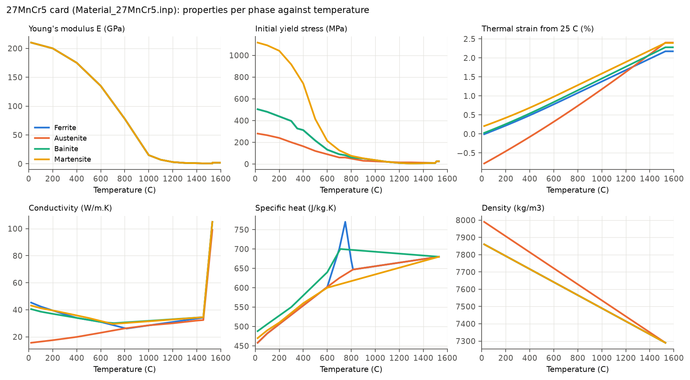
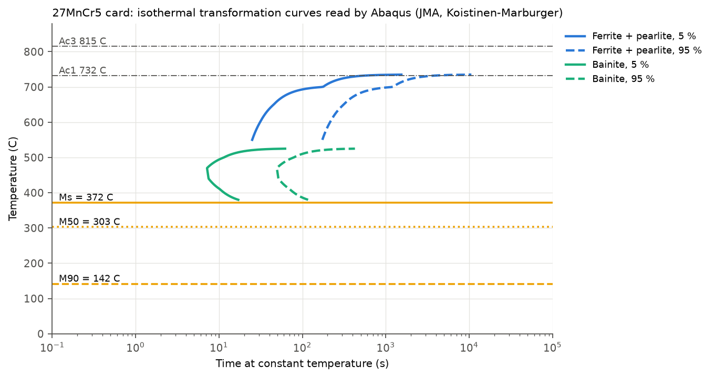
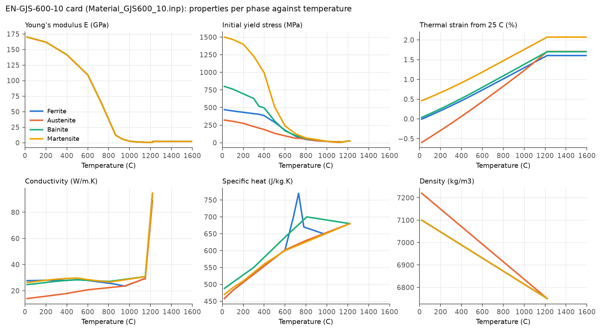
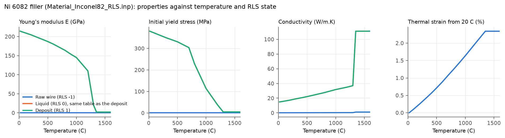
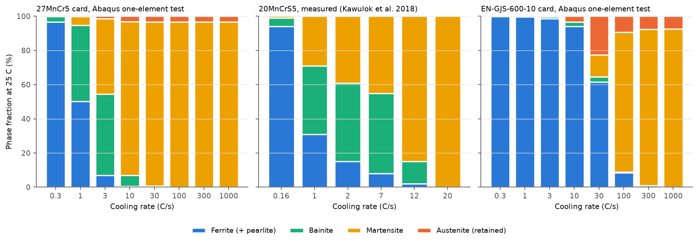
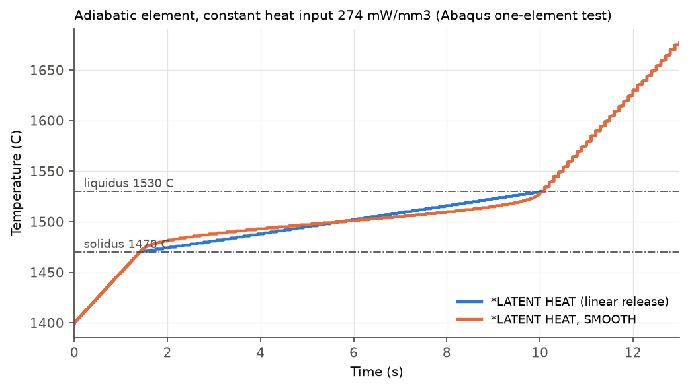
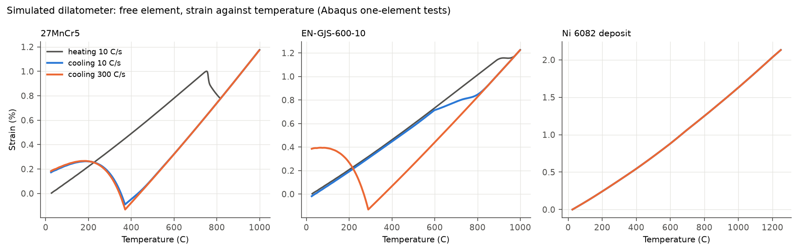

# Metallurgical Phase Transformation Cards: One-Element Verification

### How the material cards of the laser weld model (project 02) behave in the Abaqus metallurgical phase transformation framework, one property at a time

The crown gear (27MnCr5), the differential carrier (EN-GJS-600-10) and the filler wire (Ni 6082) of [project 02](../02_dflux_laser_welding/) are modelled with the built-in metallurgical phase transformation framework of Abaqus/Standard. A card of this kind carries a melting range, a list of solid phases, the transformations between them with their kinetics, and every thermal and mechanical property as a function of the phase fractions. In a model of 2.8 million equations none of this can be checked directly. This folder runs each part of the cards on one or two elements, where the result can be compared with the card data, with a hand calculation and, where it exists, with measured data.

The checks found two errors inherited by the cards and one rule copied from the documentation that does not belong in them; all three are corrected (section 4). They also settle how the framework reads two of its tables, which the guide leaves open (sections 1 and 3).

---

## Contents

1. [The framework in brief](#1-the-framework-in-brief)
2. [The three cards](#2-the-three-cards)
3. [One-element tests and results](#3-one-element-tests-and-results)
4. [Corrections made to the cards](#4-corrections-made-to-the-cards)
5. [Limitations and open points](#5-limitations-and-open-points)
6. [Files and how to run](#6-files-and-how-to-run)
7. [References](#7-references)

---

## 1. The framework in brief

The framework is an internal user-defined field (USDFLD) that Abaqus evaluates at every integration point [1]. A material uses it when its name starts with `ABQ_` or when it is declared with `USER TYPE=PHASE_TRANSFORMATION`; the cards of project 02 use the name form (`ABQ_PHASE_TRANS_27MNCR5`, ...), which the guide accepts as an alternative to the user type.

| Card item | What Abaqus does with it |
| :--- | :--- |
| `ABQ_PHASE_TRANS_MeltingTemperature` | solidus and liquidus of the raw / liquid / solid state RLS (SDV1: -1 raw, 0 liquid, 1 solid) |
| `ABQ_PHASE_TRANS_SolidPhases` | the solid phases and the phase formed on solidification; their volume fractions are SDV4 onwards, in this order |
| `ABQ_PHASE_TRANS_Transformations` | each transformation: temperature-rate condition (cooling / heating), temperature window, diffusional or martensitic, input option (TTT, JMA or KM), parent and child phases |
| Diffusional kinetics | Johnson-Mehl-Avrami law with a fictitious time for continuous cooling; `ParentEquiFrac` is the parent fraction left at equilibrium: for t -> infinity the parent tends to f_tot x f_eq, so f_eq = 0 lets the transformation run to completion |
| Martensitic kinetics | Koistinen-Marburger law f_M = (f_A(Ms) - f_r) (1 - exp(-gamma (Ms - T))), with Ms the upper bound of the temperature window and f_r read from `ParentRetainedFrac` |
| `ABQ_PHASE_TRANS_FieldVariables` | field variables for the properties: RLS, or the volume fraction ratios r_i = f_i / (f_1 + ... + f_i), i > 1 |
| `*DEPVAR` | at least 3 + n_phases + 3 n_transformations state variables (25 for the steel and the cast iron: 4 phases, 6 transformations) |

Two statements of the guide needed a test (section 3): the retained-fraction table is read with the **absolute** austenite fraction at Ms (not the fraction relative to austenite + martensite), and a property given only for the four pure phases, interpolated in the ratios r_2 to r_4, gives exactly the **rule of mixtures** sum f_i P_i. The table type reference also calls the martensitic TTT constants proportions of the parent phase, while the calibration formula and the verification input of the same guide use them as proportions of the child phase; the cards use the second reading.

Outside the framework, and therefore outside these cards' kinetics: `*ANNEAL TEMPERATURE` (a plain Abaqus option, a reset of the plastic strain above one temperature), the enthalpy of the solid-state transformations (no input exists; it would need a `HETVAL` subroutine) and transformation plasticity.

---

## 2. The three cards

All three cards are estimated, not measured: they are built from published relations and from the composition and microstructure reported for the joint in three public theses [10-12]. Each card lists its sources in its header.

### 2.1 Crown gear: 27MnCr5

Composition 0.27 C - 0.25 Si - 1.25 Mn - 1.20 Cr (wt%), the midpoint of the range of the crown steel in Nogueira [10], Neto [11] and Maia [12] (C 0.23-0.31, Mn 1.10-1.40, Cr 1.00-1.40). The card is a 16MnCr5 base card shifted for the composition, in two steps (16MnCr5 -> 20MnCr5 -> 27MnCr5).

| Quantity | 27MnCr5 card | Origin |
| :--- | :--- | :--- |
| Ac1 / Ac3 | 732 / 815 C | Andrews [4]: Ac3 = 910 - 203 sqrt(C) + 44.7 Si gives 815.7 C |
| Bs / Ms | 537 / 372 C | Li et al. [3] for Bs; Andrews [4] for Ms (372.3 C), confirmed by Steven and Haynes [5] (371.4 C) |
| Solidus / liquidus, latent heat | 1455 / 1530 C, 280 kJ/kg | linear solidus depression for +0.075 % C against 20MnCr5 (-15 K); liquidus and latent heat of the base card |
| Austenite -> ferrite + pearlite | 550-785 C, JMA, n = 2.10 | times of the base card scaled by the 27MnCr5 / 20MnCr5 ratio of the reaction-rate model of Li et al. [3] (x 2.3 at 550 C to x 6.8 at 735 C); k and n computed from them with the calibration of the guide [1] |
| Austenite -> bainite | 372-537 C, JMA, n = 2.11 | Li et al. [3] for this composition, ASTM grain size 8 (x 2.2 slower than 20MnCr5) |
| Austenite -> martensite | below 372 C, KM, gamma = 0.01 1/K | Koistinen and Marburger [6]: 50 % at 303 C, 90 % at 142 C, 3.1 % retained austenite at 25 C |
| Flow curves | base curves x 1.20 (ferrite), x 1.20 (bainite), x 1.255 (martensite), fading to x 1.0 between 800 and 1100 C | phase hardness ratios of Maynier et al. [7]; martensite 1117 MPa initial yield at 20 C. Maynier gives 522 HV for 0.27 % C martensite, against about 550 HV measured in the coarse-grained heat affected zone of the joint [11] |
| E, nu, density, conductivity, specific heat | E = 210 GPa and nu = 0.33 for every phase at 20 C; the other tables those of the base card, with the transition points moved to the new Ac1, Ac3 and solidus | the steel grades differ little in these properties |
| Thermal expansion | secant from `ZERO = -273.15 C`, each phase tied to the others by the specific volumes of Lement [8] for 0.27 % C, frozen above the liquidus | gives contraction on austenitisation and expansion at Ms with the right size (section 3.5) |

<p align="center">
  
</p>

The conductivity rises to about 100 W/m.K in the liquid: the usual enhanced conductivity that stands for the stirring of the pool in a conduction model. The specific heat carries the magnetic (Curie) peak on the ferrite only; the bainite and martensite curves above Ac1 are never reached, because those phases turn to austenite there.

<p align="center">
  
</p>

The curves are drawn as Abaqus reads the tables: k and n interpolated linearly in temperature between the table points. The austenite -> ferrite table has points at 550, 600, 650, 700 and 735 C only, and k falls by almost two orders of magnitude between the last two, so between 700 and 735 C the linear interpolation keeps k close to its 700 C value and the ferrite starts much earlier than the times the table was built from (at 720 C, start at about 260 s against about 610 s with a log-linear interpolation of the same points). The heating tables already carry extra points for this reason; the cooling tables do not yet (section 5).

### 2.2 Differential carrier: EN-GJS-600-10

Solid-solution strengthened ferritic spheroidal graphite iron, typical composition 3.2 C - 4.2 Si - 0.25 Mn (Nogueira [10]: C 3.1-3.4, Si 4.2-4.5; ferritic matrix, pearlite < 5 %, cementite < 1 %). A first approximation, with the four phases and the layout of the steel card so that both materials run in the same model:

| Quantity | Card | Origin |
| :--- | :--- | :--- |
| Phases | ferrite = as-cast ferritic matrix; austenite = matrix austenite with about 0.5 % C from graphite dissolution; bainite = ausferrite / bainite; martensite = high-carbon martensite | |
| Ac1 / Ac3 | 850 / 970 C | silicon raises the eutectoid range; calculated values for 4 % Si irons 840-906 and 900-990 C [13] |
| Ms | 290 C | Andrews-type formula with 0.5 % C and 4.2 % Si in the austenite |
| Solidus / liquidus, latent heat | 1150 / 1220 C, 230 kJ/kg | eutectic of a 4.2 % Si iron, widened to 70 K; handbook latent heat |
| Room temperature | density 7100 kg/m3, E = 170 GPa, nu = 0.275, Rp0.2 = 470 MPa, Rm = 600 MPa | EN 1563 [9] |
| Kinetics | Li et al. [3] with 0.5 C - 4.2 Si - 0.25 Mn (outside its silicon range); ferrite -> austenite ten times slower than in steel (carbon from the nodules), assumed | |
| Retention rule | (0, 0), (0.25, 0.25), (0, 1): no martensite when 25 % austenite or less is left at Ms | kept for now: austenite retention is reported in the heat affected zone of the joint [11], but its amount has no source yet (section 5) |

<p align="center">
  
</p>

### 2.3 Filler wire: Ni 6082

Nickel filler ERNiCr-3 (AWS A5.14, ISO 18274 S Ni 6082), one austenitic phase, no solid-state transformation. The framework is used for its RLS state only: field variable 1 = RLS, so the wire ahead of the beam is raw (RLS = -1: 1 % of the conductivity of the deposit, E = 214 MPa, yield 1 MPa, a quiet element in the stress run) and becomes deposit when it melts (solidus 1300 C, liquidus 1350 C, latent heat 300 kJ/kg, anneal at 1350 C). Density, specific heat and expansion are those of the deposit in every state, so the beam heats and melts the wire with its real heat capacity and latent heat.

<p align="center">
  
</p>

---

## 3. One-element tests and results

Temperatures are imposed on every node (heat transfer: `*BOUNDARY` on degree of freedom 11; stress: `*TEMPERATURE`), with fixed increments of about 2 C, and the results are printed to the `.dat` file at the element centroid. The layout follows the one-element verification input of the guide [1], with the cards of project 02 and temperature histories written for this project.

### 3.1 Phase fractions after continuous cooling (PT01)

Austenitised at 1000 C for 10 s (100 % austenite in every hold), then cooled to 25 C at a constant rate:

| Cooling rate (C/s) | 0.3 | 1 | 3 | 10 | 30 | 100 | 300 | 1000 |
| :--- | :--- | :--- | :--- | :--- | :--- | :--- | :--- | :--- |
| 27MnCr5: ferrite / bainite / martensite / austenite (%) | 97 / 3 / 0 / 0 | 50 / 45 / 5 / 0 | 7 / 47 / 44 / 2 | 1 / 6 / 90 / 3 | 0 / 1 / 96 / 3 | 0 / 0 / 97 / 3 | 0 / 0 / 97 / 3 | 0 / 0 / 97 / 3 |
| EN-GJS-600-10: ferrite / bainite / martensite / austenite (%) | 100 / 0 / 0 / 0 | 100 / 0 / 0 / 0 | 99 / 1 / 0 / 0 | 94 / 3 / 0 / 3 | 62 / 3 / 13 / 22 | 8 / 1 / 82 / 9 | 1 / 0 / 92 / 7 | 0 / 0 / 93 / 7 |

<p align="center">
  
</p>

- **The cards are read as written.** 27MnCr5: martensite starts at 369 C (card 372 C), 50 % at 303 C, 3.3 % retained austenite at the fast rates (Koistinen-Marburger: 3.1 %). Cast iron: Ms 287 C (card 290 C), 7.4 % retained austenite (7.1 %).
- **Against measured data.** No measured CCT of 27MnCr5 was found. The nearest is the dilatometric CCT of 20MnCrS5 by Kawulok et al. [2] (C 0.17-0.22, same Mn and Cr, austenitised at 850 C), whose shares are shown in the middle panel (read from its Fig. 10c, ferrite and pearlite together as in the cards). With more carbon, 27MnCr5 must transform at least as slowly, so the measured steel is a bound. From 3 C/s the card agrees with it (7 % ferrite at 3 C/s against 15 % at 2 C/s in the leaner steel, full martensite above about 20 C/s). At 1 C/s it does not: **50 % ferrite against about 31 %** in the leaner steel, so the ferrite of the card is still too fast near 1 C/s. The heat affected zone of the laser weld cools far faster than 30 C/s, where the card and the bound agree (section 5).
- **The cast iron** keeps its ferritic matrix down to 10 C/s and needs about 100 C/s for martensite; at 30 C/s the retention rule leaves 22 % austenite (section 3.2).

A Python version of the same equations (JMA with fictitious time, Koistinen-Marburger, constant extrapolation outside the tables) reproduces these fractions within 0.7 % at every rate for both cards and is used for the diagrams.

### 3.2 Retained-fraction rule (PT02)

Synthetic three-phase card (ferrite, austenite, martensite): 80 % ferrite formed in a 300 s hold at 600 C, then a quench to 25 C at 100 C/s.

| Element | Retention table | Martensite at 25 C | Austenite at 25 C | Absolute reading predicts | Relative reading predicts |
| :--- | :--- | :--- | :--- | :--- | :--- |
| E1 | (0, 0), (0.25, 0.25), (0, 1) | **0.000** | 0.200 | 0.000 | 0.195 |
| E2 | (0, 0), (0, 1) | **0.195** | 0.005 | 0.195 | 0.195 |
| E3 (no ferrite, quench from 900 C) | (0, 0), (0.25, 0.25), (0, 1) | **0.973** | 0.027 | 0.976 | 0.976 |

The table is read with the absolute austenite fraction at Ms: with the rule, any point that reaches Ms with 25 % austenite or less keeps all of it. The cast-iron run of PT01 confirms it with no synthetic data (30 C/s: 35.6 % austenite at Ms, rule -> 21.5 % retained, martensite 13.1 % expected, 13.0 % computed). The rule is the table of the verification input of the guide [1], not data of any steel; in a steel with 0.27 % C the carbon-enriched austenite left by ferrite mostly turns to martensite, so it was removed from the steel card (section 4).

### 3.3 Properties of a phase mixture (PT03)

Quench to 316 C at 1000 C/s (Koistinen-Marburger: 50 % martensite, 50 % austenite), hold, then a 10 MPa uniaxial stress. The thermal strain, which differs strongly between the two phases, discriminates the interpolation:

| | Abaqus | Rule of mixtures | Pure austenite | Pure martensite |
| :--- | :--- | :--- | :--- | :--- |
| Thermal strain at 316 C | 1.6599E-3 | 1.6600E-3 (-0.01 %) | -2.37E-3 | +5.69E-3 |
| Young's modulus (MPa) | 185 529 | 185 500 (+0.02 %) | 185 500 | 185 500 |

Over the whole quench (500 increments) the thermal strain stays within 1.0E-6 of the rule of mixtures: a property given only for the four pure phases is mixed linearly in the phase fractions. (The run used the 20MnCr5 card, before the change of steel; the interpolation does not depend on the card.)

### 3.4 Latent heat of fusion (PT04)

Two adiabatic elements with the latent heat of the steel (280 kJ/kg, 1470-1530 C) and a constant heat input of 274 mW/mm3 (50 C/s of sensible heating):

<p align="center">
  
</p>

| | Linear release | `*LATENT HEAT, SMOOTH` | Hand calculation |
| :--- | :--- | :--- | :--- |
| Time from solidus to liquidus | 8.60 s | 8.70 s | 60 / 50 + 2044 / 274 = 8.66 s |
| First 15 K above the solidus | 2.10 s | 1.00 s | linear 2.17 s; smooth 1.07 s (U = L xi^3 (10 - 15 xi + 6 xi^2)) |

`SMOOTH` releases the same energy with zero first and second derivatives at the solidus and the liquidus, concentrated at mid-range (apparent specific heat 1.875 times the linear one there). Both converge in one iteration per increment on one element, so the benefit for the Newton iterations of the weld model cannot be measured here; the weld cards keep the linear release, with which the heat source was calibrated.

### 3.5 Simulated dilatometer (PT05)

A free element heated at 10 C/s, held, cooled at 10 C/s, reheated and cooled at 300 C/s (no stress: |S| < 2E-14 MPa throughout):

<p align="center">
  
</p>

| Card | Heating | Strain at 25 C after cooling at 10 C/s | after 300 C/s |
| :--- | :--- | :--- | :--- |
| 27MnCr5 | mean expansion coefficient 13.8E-6 1/K to 750 C; contraction on austenitisation between 750 and 800 C | +0.173 % (90 % martensite) | +0.183 % (97 % martensite) |
| EN-GJS-600-10 | small contraction between 900 and 950 C | -0.018 % (94 % ferrite: back to the start) | +0.385 % (92 % martensite) |
| Ni 6082 | mean coefficient 17.4E-6 1/K to 1250 C, no transformation | 0.000 % | 0.000 % |

The residual expansion of the martensitic steel, +0.17 to +0.18 %, matches the specific volumes of Lement [8] for 0.27 % C (martensite against ferrite + cementite: 0.51 % in volume, 0.17 % linear). The transformation strains therefore have the right sign and size: contraction on heating through Ac1-Ac3, expansion at Ms on cooling, more expansion for the carbon-richer martensite of the cast iron.

---

## 4. Corrections made to the cards

| Finding | Effect | Correction |
| :--- | :--- | :--- |
| 20MnCr5 base card: the austenite -> ferrite JMA coefficients (the data Abaqus reads) did not match the TTT times of the same card; the Avrami exponent had been changed (2.15 to 2.40) without recomputing the rate constant | ferrite start times 24 to 124 % longer than the card's own TTT data | k and n computed from the TTT times with the calibration of the guide (n = 2.10); carried into the 27MnCr5 card. Bainite and the cast-iron kinetics agreed within 1 % and were not changed |
| Retained-fraction rule (0.25, 0.25) in the steel card | no martensite where 25 % austenite or less is left at Ms, e.g. the intercritical edge of the heat affected zone (section 3.2) | removed from the steel card; retained austenite from Koistinen-Marburger alone |
| Field-variable columns labelled as phase fractions | none on the results: they are the ratios r_2 to r_4 | comments corrected |
| TTT tables next to JMA or KM input | not read by Abaqus; a change to them has no effect | kept as commented reference data, with the meaning of the martensitic constants |
| Crown steel 20MnCr5 (stand-in) | the theses' crown steel is 27MnCr5 | 27MnCr5 card built (section 2.1); the thermal tables are identical, so the thermal run of project 02 is kept |

---

## 5. Limitations and open points

- **Ferrite of 27MnCr5 near 1 C/s too fast** against the 20MnCrS5 bound (section 3.1). It does not touch the weld model (the heat affected zone cools at hundreds of C/s), but it does matter for slower cycles (preheating, post-weld heat treatment). Part of it is numerical: the coarse austenite -> ferrite table is interpolated linearly in k (section 2.1); the first step is to add log-linear intermediate points to the cooling tables, as already done for heating, and to repeat PT01. A measured CCT of 27MnCr5 is then needed to recalibrate the kinetics themselves.
- **Ms is fixed.** In the measured CCT, Ms falls at slow rates as the remaining austenite is enriched in carbon; the cards keep one Ms.
- **No ledeburite.** The partially melted zone of the cast iron forms martensite and ledeburite, with hardness above 800 HV [11]; the card has no phase for the eutectic carbide.
- **Retention in the cast iron** is the guide's rule, kept because retained austenite is reported in the heat affected zone of the joint [11], with no measured amount.
- **Not in the framework:** enthalpy of the solid-state transformations (16 J/g for alpha -> gamma against 280 J/g for melting), transformation plasticity, grain growth and its effect on the kinetics.
- **Estimated data.** No card property was measured on the materials of the joint; every value comes from the relations and sources of section 2.

---

## 6. Files and how to run

| File | Content |
| :--- | :--- |
| `tests/PT01_cct_27MnCr5.inp`, `tests/PT01_cct_GJS600_10.inp` | model CCT: one DC3D8, austenitising and cooling at eight rates |
| `tests/PT01_cct_20MnCr5.inp` | the same for the former 20MnCr5 stand-in, kept for comparison |
| `tests/PT02_retention_rule.inp` | three DC3D8, synthetic three-phase card, with and without the retention rule |
| `tests/PT03_mixture_elastic.inp` | one C3D8, 27MnCr5: quench to 303 C (50 % martensite) and uniaxial stress |
| `tests/PT04_latent_heat.inp` | two adiabatic DC3D8: linear and `SMOOTH` latent heat |
| `tests/PT05_dilatometry_27MnCr5.inp`, `..._GJS600_10.inp`, `..._Inconel82.inp` | one free C3D8: simulated dilatometer |

The decks include the cards of project 02, copied next to the deck before running (`Material_phase_trans_table_types.inp` and `Material_27MnCr5.inp`, `Material_GJS600_10.inp` or `Material_Inconel82_RLS.inp` from `02_dflux_laser_welding/PRESS_RLS`):

```bash
abaqus job=PT01_cct_27MnCr5 input=PT01_cct_27MnCr5.inp interactive
# results: *EL PRINT tables in PT01_cct_27MnCr5.dat (centroid values); the ODB keeps the same history output
```

Units: mm, s, tonne, N, MPa, mJ, C. Abaqus/Standard 2025x.

---

## 7. References

1. Dassault Systemes, Abaqus Materials Guide, 2025: Modeling Metallurgical Phase Transformations; Parameter and Property Table Type Reference; Latent Heat; Specifying Material Data as Functions of Temperature and Independent Field Variables. Cited, not reproduced.
2. R. Kawulok, P. Kawulok, I. Schindler, P. Opěla, S. Rusz, V. Ševčák, Z. Solowski, Study of the effect of deformation on transformation diagrams of two low-alloy manganese-chromium steels, Archives of Metallurgy and Materials 63 (2018) 1735-1741, https://doi.org/10.24425/amm.2018.125099
3. M. V. Li, D. V. Niebuhr, L. L. Meekisho, D. G. Atteridge, A computational model for the prediction of steel hardenability, Metallurgical and Materials Transactions B 29 (1998) 661-672, https://doi.org/10.1007/s11663-998-0101-3
4. K. W. Andrews, Empirical formulae for the calculation of some transformation temperatures, Journal of the Iron and Steel Institute 203 (1965) 721-727.
5. W. Steven, A. G. Haynes, The temperature of formation of martensite and bainite in low-alloy steels, Journal of the Iron and Steel Institute 183 (1956) 349-359.
6. D. P. Koistinen, R. E. Marburger, A general equation prescribing the extent of the austenite-martensite transformation in pure iron-carbon alloys and plain carbon steels, Acta Metallurgica 7 (1959) 59-60, https://doi.org/10.1016/0001-6160(59)90170-1
7. P. Maynier, B. Jungmann, J. Dollet, Creusot-Loire system for the prediction of the mechanical properties of low alloy steel products, in: Hardenability Concepts with Applications to Steel, AIME (1978) 518-545.
8. B. S. Lement, Distortion in Tool Steels, American Society for Metals (1959).
9. EN 1563:2018, Founding - Spheroidal graphite cast irons.
10. L. F. J. Nogueira, Rotura diferida em soldadura laser de materiais dissimilares, MSc thesis, University of Coimbra (2021), https://hdl.handle.net/10316/97996 (CC BY 4.0).
11. A. Neto, MSc thesis, University of Aveiro (2023), https://hdl.handle.net/10773/41648 (CC BY 4.0).
12. V. H. F. Maia, MSc thesis, University of Aveiro (2023), https://hdl.handle.net/10773/39345 (CC BY 4.0).
13. J. Roučka, E. Abramova, V. Kaňa, Archives of Metallurgy and Materials 63 (2018) 601-607.
