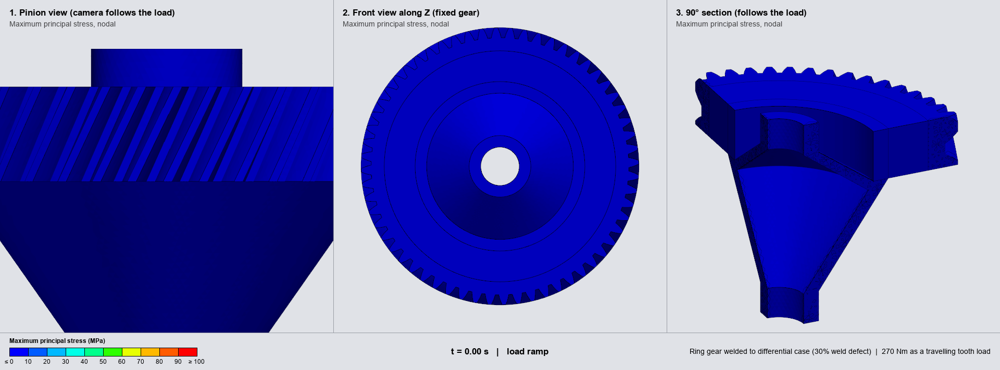
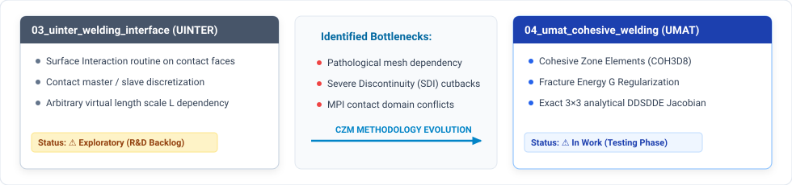

# Advanced Abaqus User Subroutines Portfolio

[](#)
[](https://www.3ds.com/)
[](https://fortran-lang.org/)
[](LICENSE)

A repository of production-grade user subroutines for <b>Abaqus/Standard</b> and <b>3DEXPERIENCE SIMULIA</b>, written in <b>Fortran</b> for high-performance structural, fatigue, and manufacturing simulations.

---

## Portfolio Projects & Subroutine Implementations

| ID | Subroutine | Physics / Type | Engineering Application | Status |
| :---: | :--- | :--- | :--- | :---: |
| **01** | [`DLOAD`](01_dload_gear_fatigue/README.md) | Moving Surface Load / Quasi-Static | Drive + coast rolling load and fatigue framework for a welded helical crown gear and differential carrier | ✅ Verified |
| **02** | [`DFLUX`](02_dflux_laser_welding/README.md) | Moving Keyhole Flux / Thermo-Metallurgical-Mechanical | Laser welding of a steel crown gear to a cast-iron carrier: phase transformations, raw-wire (RLS) filler vs element activation, residual stress | ✅ Thermal verified, stress in work |
| **03** | [`UINTER`](03_uinter_welding_interface/README.md) | Surface Interaction / BTR Hot Cracking | 3-State contact interface (Raw → Welded → Cracked) with BTR criteria | ⚠️ Exploratory (R&D Backlog) |
| **04** | [`UMAT`](04_umat_cohesive_welding/README.md) | Cohesive Zone Modeling / Fracture Energy *G*<sub>c</sub> | Mesh-independent 3-state thermo-mechanical weld interface (`COH3D8`) | ⚠️ In Work (Testing Phase) |
| **05** | [`USDFLD`](05_usdfld_shaft_straightening/README.md) | Radial Field Variable / Nonlinear Kinematic Hardening | Elastoplastic straightening & springback of case-hardened transmission shaft (DOI: [10.1007/s00170-014-5688-8](https://doi.org/10.1007/s00170-014-5688-8)) | ⚠️ In Work (Not Validated) |
| **06** | [`UMATHT`](06_umatht_hydrogen_diffusion/README.md) | Hydrogen Transport / Heat Transfer Analogy | Oriani trapping and stress-driven diffusion for delayed (cold) cracking of welds | ⚠️ In Work (Abaqus Run Pending) |

---

### Project Showcase: 01. Helical Crown Gear & Carrier Assembly (`DLOAD`)

<p align="center">
  <a href="01_dload_gear_fatigue/README.md">
    
  </a>
</p>

Finite element simulation (1.49 million equations) of an automotive helical crown gear (20MC5) laser-welded with Inconel filler wire to its differential carrier (EN-GJS-600-10), with a 108° incomplete-penetration weld flaw (30 % of the circumference). The tooth contact load is applied analytically by a <code>DLOAD</code> subroutine and rolled across the full 360° revolution, in drive and in coast (regeneration), without meshing the pinion.

#### Key Features & Verification:
- **Drive and Coast Load Cases:** active flank and torque selected per analysis step, covering manual drivelines and hybrid / electric drivelines with torque reversal.
- **Constant Transmitted Torque:** the pressure field integrates to $+270.03\text{ N}\cdot\text{m}$ (drive) and $-270.11\text{ N}\cdot\text{m}$ (coast) over the flank surfaces, with ripple below $0.15\%$ through the revolution.
- **Finite Element Load Path:** reaction torque at the bearing reference node $-270.13\text{ N}\cdot\text{m}$ against $-270.0$ applied ($0.05\%$), averaged over the full revolution; transverse and axial bearing forces within $0.1\%$ of gear force theory.
- **Welded Assembly:** bonded weld seam over 252°, frictional contact across the unbonded flaw, kinematic couplings at the bearing seats.
- **Fatigue Method:** stress-range evaluation per critical point with S-N curves and Palmgren-Miner damage summation for an OEM load spectrum.

Detailed formulation, kinematic equations, FEA verification, and post-processing scripts are available in <a href="01_dload_gear_fatigue/README.md">01_dload_gear_fatigue/</a>.

---

### Project Showcase: 02. Laser Welding of a Crown Gear to a Cast-Iron Carrier (`DFLUX`)

<p align="center">
  <a href="02_dflux_laser_welding/README.md">
    
  </a>
</p>

A 20MnCr5 crown gear laser welded to an EN-GJS-600-10 differential carrier with a Ni 6082 filler wire (<i>R</i> = 55 mm, 4 kW, 1.5 m/min, full penetration of a 5 mm weld land into a gas escape chamber, press fit below). The animation shows the unrolled top surface, the longitudinal section on the joint, the projected weld cross-section with the solidus and Ac1 lines of each material, and the expected etched macrograph.

#### Key Highlights:
- **Double conical keyhole source (`DFLUX`):** nail-head weld (wide head, narrow body, hemispherical tip), calibrated on a published macrograph, with the power through the keyhole root lost into the chamber.
- **Mesh built for a moving source:** a quad section revolved in 600 steps of 0.6 deg, one element per increment so the beam sits on a node at every increment end; tetrahedra away from the weld, tied, on plain cards.
- **Metallurgy in all three materials:** the Abaqus phase transformation framework (`ABQ_PHASE_TRANS`) with phase-dependent properties, JMA / Koistinen-Marburger kinetics and secant transformation strains.
- **Filler as a raw wire (RLS state):** the wire is in the model from the start and becomes weld metal where the computed temperature melts it, in one weld step, compared with classic element activation (`*MODEL CHANGE`) on the same mesh.
- **Stress run (in work):** press fit by interference saved once by restart, weld and cooling read the thermal history increment by increment.

Formulation, mesh, materials, input decks and results are in <a href="02_dflux_laser_welding/README.md">02_dflux_laser_welding/</a>.

---

### Project Showcase: 03 & 04. Advanced Interface Modeling Evolution

The portfolio demonstrates a complete engineering R&D cycle comparing two distinct methodologies to capture the 3 physical states of a welded interface (<b>Raw → Welded → Cracked</b>):

<p align="center">
  
</p>

<ul>
  <li><b><a href="03_uinter_welding_interface/README.md">03. Exploratory Interface (UINTER)</a>:</b> Formulates the 3-state state machine on contact surfaces. Benchmarking identified critical mesh-dependency due to displacement jumps vs strain rates, prompting its classification as an exploratory R&D backlog module.</li>
  <li><b><a href="04_umat_cohesive_welding/README.md">04. Cohesive Zone Interface (UMAT)</a>:</b> Under active development and testing to evaluate mesh-independent fracture energy <i>G</i><sub>c</sub> regularization. Uses an exact 3 × 3 analytical <code>DDSDDE</code> Jacobian to investigate convergence without contact chattering or SDI cutbacks (strictly a research prototype under evaluation, not for production use).</li>
</ul>

---

### Project Showcase: 05. Shaft Straightening & Springback (`USDFLD`)

<p align="center">
  <a href="05_usdfld_shaft_straightening/README.md">
    
  </a>
</p>

Three-point press straightening and springback of a case-hardened 20MnCr5 secondary transmission shaft of the type studied by Husson et al. (<i>L</i> = 294.1 mm, DOI: <a href="https://doi.org/10.1007/s00170-014-5688-8">10.1007/s00170-014-5688-8</a>). A <code>USDFLD</code> subroutine maps the radial depth below the surface to a field variable at every integration point, so the carburized case and the core are one continuous material with depth-dependent properties, without partitioning the geometry into layers.

#### Key Modelling Features:
- **Radial Property Gradient:** depth below the stepped outer surface computed per integration point and passed to `*PLASTIC, DEPENDENCIES=1`; initial yield stress from 1900 MPa at the surface to 750 MPa in the core, with an effective case depth of 0.60 mm.
- **Cyclic Plasticity:** Chaboche nonlinear kinematic hardening with two backstresses combined with Voce isotropic hardening, to carry the Bauschinger effect through the reverse yielding that occurs on unloading.
- **Three-Step Solution:** equilibrium of the quenching residual stresses, displacement-controlled punch stroke, then punch retraction and evaluation of the residual Total Indicated Runout (TIR).
- **Data Provenance:** the material deck separates the published context (hardness after heat treatment, Husson et al.) from the values assumed by the author (hardness profile, case depth, hardening parameters). The model is not calibrated or validated against tests.

Formulation, parameter provenance, meshing strategy and results are available in <a href="05_usdfld_shaft_straightening/README.md">05_usdfld_shaft_straightening/</a>.

---

## Directory Layout

```text
.
├── 01_dload_gear_fatigue/
│   ├── dload_crown_helical.f                  # User Subroutine (Modern Fortran DLOAD + UEXTERNALDB)
│   ├── Gear_Shaft_assembly_simulation.inp     # Master Input Deck: drive revolution
│   ├── Gear_Shaft_assembly_drive_coast.inp    # Master Input Deck: drive + coast revolutions
│   ├── Materials_Assembly.inp                 # 20MC5 and GJS600-10 material cards
│   ├── Gear_Shaft_geometry.step               # CAD geometry: crown gear + differential carrier
│   ├── compile_vtk_to_gif.py                  # Multi-viewport visualization compiler
│   ├── odb_to_vtk.py                          # Abaqus Python ODB to VTK extractor
│   ├── run_pipeline.sh                        # Headless Linux / HPC batch execution script
│   └── README.md                              # Comprehensive Technical Report
├── 02_dflux_laser_welding/
│   ├── THERMAL_RLS/                          # Thermal deck, DFLUX keyhole source, geometry (STEP), material cards
│   ├── PRESS_RLS/                            # Stress model and press fit (writes the restart), material cards
│   ├── MECHANICAL_RLS/                       # Weld stress analysis, restart of the press fit
│   └── README.md                             # Technical Report
├── 03_uinter_welding_interface/
│   ├── uinter_btr_hot_cracking.f              # User Subroutine (UINTER State Machine in Fortran)
│   ├── dummy_btr_contact_patch.inp            # 2-Element Contact Patch Benchmark Deck
│   └── README.md                              # Technical Report & R&D Backlog Documentation
├── 04_umat_cohesive_welding/
│   ├── umat_cohesive_welding_btr.f            # Prototype User Material Subroutine (Modern Fortran)
│   ├── cohesive_weld_btr_verification.inp     # 3-Element Cohesive Zone Benchmark Deck (COH3D8)
│   └── README.md                              # Comprehensive Technical Report & Formulation
├── 05_usdfld_shaft_straightening/
│   ├── usdfld_case_hardneded_shaft.f          # User Subroutine (USDFLD radial depth field variable)
│   ├── 20MnCr5.inp                            # Depth-dependent Chaboche + Voce material deck
│   ├── husson_shaft.step                      # CAD geometry: secondary transmission shaft
│   └── README.md                              # Comprehensive Technical Report & Formulation
├── 06_umatht_hydrogen_diffusion/
│   ├── umatht_hydrogen_transport.f            # User Subroutine (UMATHT hydrogen transport, heat transfer analogy)
│   ├── hydrogen_transport_verification.inp    # 3-Bar 1D Verification Deck (permeation, traps, stress drift)
│   └── README.md                              # Technical Report, Formulation & Expected Results
├── 99_images_and_miscelania/
│   ├── gear_torque_simulation.gif             # Drive + coast three-viewport animation (6 FPS)  
│   ├── gear_shaft_cutaway.png                 # Section view of the crown gear / carrier CAD geometry (PNG)
│   ├── stress_front_view_flaw_ends.png        # Front-view stress field, drive against coast, weld flaw ends marked (PNG)
│   ├── double_cone_heat_source_plot.svg       # 4-Panel Double Conical Keyhole Source, Crown Gear / Carrier Weld (SVG)
│   ├── bimaterial_weld_rls_blackbody.gif      # Bimaterial weld thermal animation with expected macrograph (GIF)
│   ├── bimaterial_section.svg / _mesh_section.svg  # Joint section and swept hex mesh (SVG)
│   ├── bimaterial_filler_ea_vs_rls.svg        # Filler: element activation vs raw wire (SVG)
│   ├── bimaterial_rls_phase_map.svg           # RLS state and phase transformations (SVG)
│   ├── bimaterial_weld_workflow.svg           # Analysis chain of the weld model (SVG)
│   ├── bimaterial_courant_number.gif          # Courant number below / equal to / above 1 for the moving source (GIF)
│   ├── bimaterial_macrograph_vs_nogueira.png  # Measured vs simulated macrograph, Nogueira (2021), CC BY 4.0 (PNG)
│   ├── bimaterial_hardness_vs_neto.png        # Model hardness vs HV1 traverses, Neto (2023), CC BY 4.0 (PNG)
│   ├── macrograph_nogueira_2021_fig6_13a.jpg  # Published nail-head weld macrograph, Nogueira (2021), CC BY 4.0 (JPG)
│   ├── uinter_3state_state_machine.svg        # UINTER 3-State Contact State Machine & Won Criteria (SVG)
│   ├── cohesive_3state_state_machine.svg      # Cohesive Zone UMAT Architecture & Softening Law (SVG)
│   ├── uinter_vs_czm_comparison.svg           # Interface Modeling Evolution & Bottlenecks (SVG)
│   ├── shaft_straightening_schematic.svg      # Three-Point Straightening & Springback Schematic (SVG)
│   ├── shaft_straightening_pipeline_architecture.svg  # Shaft Straightening 3-Step Pipeline (SVG)
│   └── sn_curves_20mc5_gjs600_10.svg          # Design S-N Curves for 20MC5 and GJS600-10 (SVG)
├── LICENSE
└── README.md
```

---

## Disclaimer

This repository is published for professional portfolio and academic demonstration purposes. All CAD dimensions, process parameters, and metallurgical kinetics presented herein are synthetic, open-literature benchmarks designed to illustrate advanced FEA and Fortran programming methodologies, and do not represent any confidential data.

---

## Development Approach & Use of AI

The engineering content of this portfolio is the author's own: the choice of problems, the physical and numerical modelling strategy, the finite element models (geometry, meshes, materials, contact, welds and boundary conditions), the simulation campaigns on Abaqus / 3DEXPERIENCE and the judgement of whether a result is physically right. AI coding assistants were used as a productivity tool, under the author's direction, to speed up the writing and adaptation of Fortran subroutines, pre- and post-processing scripts, numerical cross-checks and documentation. Generated code is not taken on trust: projects marked as verified are checked against an analytical solution, an independent numerical integration or the solver's own reaction output, as documented in each project, and work still in progress is labelled as such in the table above.

---

## Author & Contact

**Victor Maia**  
- **Email:** [vhfm08@gmail.com](mailto:vhfm08@gmail.com)  
- **GitHub:** [@vhfmaia](https://github.com/vhfmaia)  
